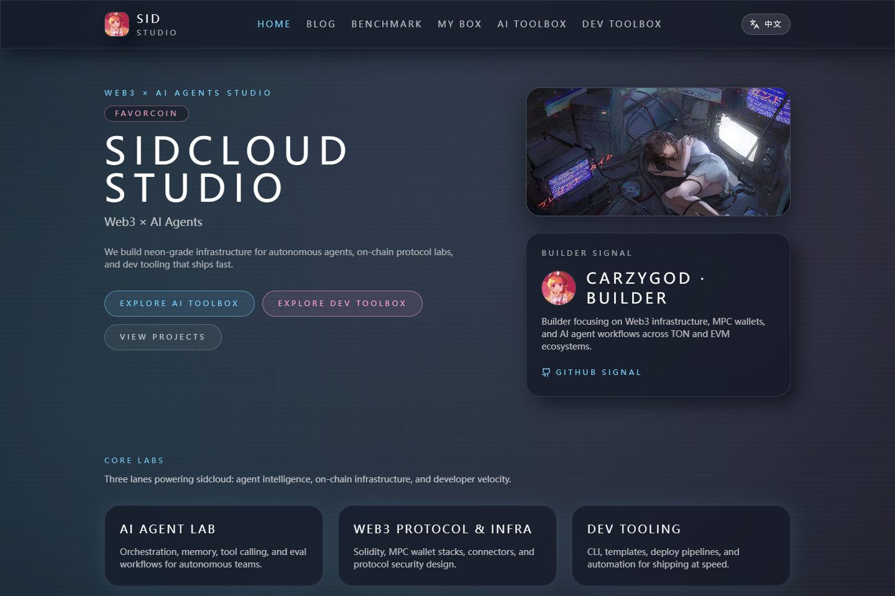
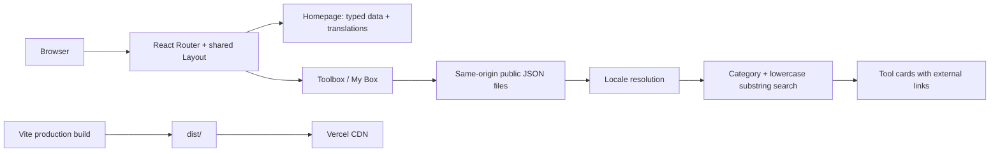

# sidcloud Studio Website

[English](README.md) · [简体中文](README.zh-CN.md) · [Live website](https://www.sidcloud.cn/) · [Current GitHub profile](https://github.com/wikigsroom)

The official sidcloud Studio website: a bilingual studio profile, project showcase, AI directory and personal application catalog. This repository is the maintained source for the website, its Vercel operating procedure and its reproducible documentation media.



## See it in use


[Desktop walkthrough, MP4](docs/media/desktop-tour.mp4) · [Mobile walkthrough, MP4](docs/media/mobile-tour.mp4) · [All screenshots and recordings](docs/media/README.md)

The recordings show actual local production-build interactions. Documentation capture blocks the decorative external Live2D widget and Google Fonts, using CSS system-font fallbacks. GIF playback is accelerated. See the [capture procedure](docs/en/media.md) and [file manifest](docs/media/manifest.json).

## What is implemented

| Surface | Route | Behavior |
| --- | --- | --- |
| Studio homepage | `/` | Introduction, three focus areas, six featured projects, dated updates, image gallery and builder profile |
| AI Toolbox | `/aitoolbox` | 76 entries in three categories, text search, category filtering and external links |
| My Box | `/mybox` | 18 personal products/projects in ten categories, with localized descriptions and search |
| Dev Toolbox | `/devtoolbox` | Five demonstration entries and five category filters; the links are currently placeholders |
| Unknown route | `*` | Client-side “Signal Lost” page with a home link |
| Shared navigation/footer | All routes | Chinese/English switch, persisted language, Telegram, struck-through former GitHub link and the current GitHub profile |

The footer deliberately keeps `Github(惨遭封禁)` struck through and places a GitHub icon plus `现任仓库` immediately to its right, linking to `https://github.com/wikigsroom`.

This is a static React application. Editing a directory entry means changing its source file and publishing a new build. The blog and the private research workspace are maintained separately.

## Architecture and usage logic



`main.tsx` mounts React, the router, metadata provider and i18n. `App.tsx` selects a page and adds transitions. `Layout.tsx` supplies the shared header, footer and widget. AI Toolbox fetches `/main.json`; My Box fetches `/myapp.json`. Filtering runs entirely in the browser over the loaded array, with no search service.

The language detector checks `localStorage["sidcloud-lang"]`, then the browser language. Supported locales are `en-US` and `zh-CN`; the UI fallback is English. Catalog text resolution tries the requested locale, English, then Chinese. A truthy but damaged translation does not trigger fallback, so the inherited Chinese catalog text issues are explicitly tracked in [known limitations](docs/en/known-issues.md).

## Run locally

Use a native Node.js installation and npm. Node 22 is used for local checks and CI; the existing Vercel project uses Node 24. No application secret or `.env` file is required.

```sh
git clone git@github.com:wikigsroom/website.git
cd website
npm ci
npm run dev
```

Open the local URL printed by Vite. For the production bundle:

```sh
npm run check
npm run preview
```

| Command | Purpose |
| --- | --- |
| `npm run dev` | Vite development server |
| `npm run build` | Build the static site into `dist/` |
| `npm run typecheck` | Check TypeScript without emitting files |
| `npm run lint` | Lint application source; generated bundles are excluded |
| `npm run check:content` | Check catalog structure, duplicate IDs, URLs, assets and build-output settings |
| `npm run check` | Typecheck, lint, content checks and production build |
| `npm run docs:media` | Build, capture page screenshots, record desktop/mobile use, and encode MP4/GIF media |
| `npm run docs:check` | Check local documentation links, media hashes/sizes and the captured source digest |
| `npm run release:check` | Run application and documentation checks together |

## Where to change content

| Change | Source |
| --- | --- |
| Navigation, former/current GitHub, Telegram | [`src/data/site.ts`](src/data/site.ts) |
| Homepage project cards | [`src/data/projects.ts`](src/data/projects.ts) |
| Profile translation keys and social identity | [`src/data/founder.ts`](src/data/founder.ts) |
| Update dates | [`src/data/updates.ts`](src/data/updates.ts) |
| Text in both UI languages | [`src/i18n/translations.ts`](src/i18n/translations.ts) |
| Active AI directory | [`public/main.json`](public/main.json) |
| Active personal app catalog | [`public/myapp.json`](public/myapp.json) |
| Developer demonstration entries | [`src/data/toolbox.ts`](src/data/toolbox.ts) |
| Image mapping and local files | [`src/data/assets.ts`](src/data/assets.ts), [`public/`](public/) |
| Footer presentation | [`src/components/Layout.tsx`](src/components/Layout.tsx) |
| Theme and animation | [`tailwind.config.ts`](tailwind.config.ts), [`src/index.css`](src/index.css) |

Use stable, unique IDs. A catalog entry contains a localized name, category, vendor, website, description, tags and source links. See the complete [content schema and editing examples](docs/en/content.md). The older `aiTools` array in `toolbox.ts` is not the active AI directory.

## Deployment with a separate Vercel account

The existing production project is `sidcloud`, owned by the `carzygodwu-2768s-projects` team. Its expected account, team/project IDs and pinned CLI version are recorded in [`operations/vercel-project.json`](operations/vercel-project.json). These are routing identifiers, not credentials.

On native Windows PowerShell, use the repository wrapper:

```powershell
pwsh -File scripts/vercel.ps1 Init
pwsh -File scripts/vercel.ps1 Login
pwsh -File scripts/vercel.ps1 Status
pwsh -File scripts/vercel.ps1 Preview
pwsh -File scripts/vercel.ps1 Production
```

`Init` creates ignored local project metadata. `Login` prints an OAuth device link; authorize the website account in a private browser window. If the isolated session already exists, use `Status` and skip logging in again.

Every account operation fixes `--global-config` to `%LOCALAPPDATA%\sidcloud\vercel-profile`, forces file credential storage, temporarily removes inherited token/project overrides, and checks the expected username and project. Process environment values are restored afterward. Credentials remain outside the repository and upload root. Preview and production deployment first run `release:check`.

[`vercel.json`](vercel.json) declares Vite, `npm run build` and output `dist/`, avoiding the existing project's generic output defaults. GitHub push and Vercel deployment are separate actions; this repository does not configure an automatic production deployment on every push. Details and recovery instructions are in [operations](docs/en/operations.md).

Domain verification files in `public/` are copied unchanged to the build root. Keep each file deployed while domain verification depends on it:

| Public verification URL | Exact body |
| --- | --- |
| [`/17df1b98016e4dce51cf8d4080665747.txt`](https://www.sidcloud.cn/17df1b98016e4dce51cf8d4080665747.txt) | `ce49460b29a0a3d3fbf87ef530c8954f96e0258c` |
| [`/b8261e943cb1290db1a42a32c0ee9566.txt`](https://www.sidcloud.cn/b8261e943cb1290db1a42a32c0ee9566.txt) | `ec8ff0c82edb079d74fc8fc19d6c709828a0650a` |

Source files and verification steps are listed in [operations](docs/en/operations.md). See the [initial verification release](docs/releases/2026-10-29-domain-verification.md) and [additional-file release](docs/releases/2026-10-29-domain-verification-b8261e94.md).

## Documentation media

Media generation additionally needs Playwright Chromium and native `ffmpeg`/`ffprobe` on `PATH`:

```sh
npx playwright install chromium ffmpeg
npm run docs:media
npm run docs:check
```

An existing Chrome installation can be selected with `PLAYWRIGHT_CHROMIUM_EXECUTABLE_PATH`; `FFMPEG_PATH` and `FFPROBE_PATH` can select codec executables. Media includes desktop and phone screenshots, both homepage languages, all tool surfaces, search, footer, client-side 404, two MP4 recordings and two animated GIFs. Temporary WebM captures stay ignored under `docs/media/.raw/`.

## Keep future updates synchronized

For every change: update the relevant code/data, add a dated entry to [CHANGELOG.md](CHANGELOG.md), update both language versions of affected documentation, regenerate media when UI source changes, run `npm run release:check`, review the staged diff, commit and push to `origin/main`. When publishing the live site, use the isolated deployment wrapper and record the deployment URL and verification in release notes.

CI runs the same release checks on pushes and pull requests. A visual-source digest rejects stale media, and asset hashes detect changed or missing screenshots/recordings. [CONTRIBUTING.md](CONTRIBUTING.md) and [AGENTS.md](AGENTS.md) make this maintenance contract explicit.

## Documentation map

| Topic | English | 简体中文 |
| --- | --- | --- |
| Architecture and runtime behavior | [Architecture](docs/en/architecture.md) | [架构与运行逻辑](docs/zh-CN/architecture.md) |
| Catalog schema and content maintenance | [Content](docs/en/content.md) | [内容维护](docs/zh-CN/content.md) |
| Account isolation, deployment and release synchronization | [Operations](docs/en/operations.md) | [部署与更新](docs/zh-CN/operations.md) |
| Screenshots, recordings and GIF reproduction | [Media](docs/en/media.md) | [媒体生成](docs/zh-CN/media.md) |
| Existing limitations and follow-up work | [Known issues](docs/en/known-issues.md) | [已知问题](docs/zh-CN/known-issues.md) |

[Initial repository release notes](docs/releases/2026-10-28.md) · [Complete media index](docs/media/README.md)
