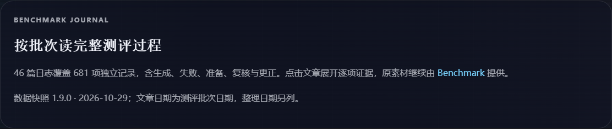
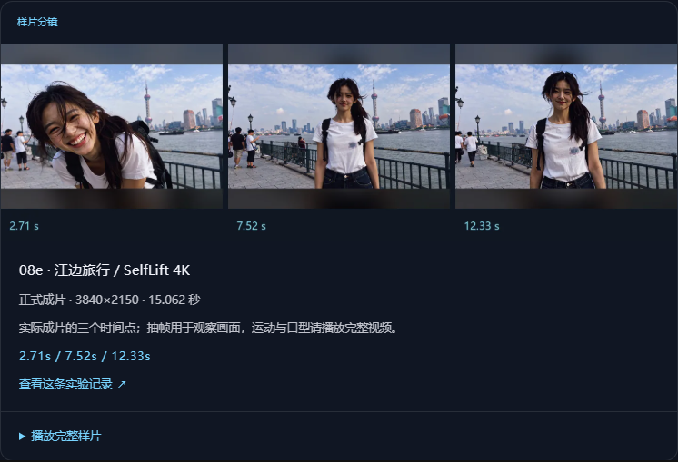

# sidcloud Notes

[English](README.md) · [简体中文](README.zh-CN.md) · [Blog branch](https://github.com/wikigsroom/website/tree/blog) · [Official website source](https://github.com/wikigsroom/website/tree/main)

The sidcloud technical blog, built with React 18, TypeScript and Vite 6. This is the **`blog` branch of `wikigsroom/website`**. The studio website is maintained separately on `main`.

Current content includes **70 articles: 46 Benchmark batch journals, 18 Research posts and six Blog notes**. The journals cover all **681 unique records** in Benchmark snapshot **1.9.0 (2026-10-29)**, including failed, pending, archived and review records. Another **89 cross-batch references** are explicitly labeled and do not count as new experiments.

Search, section/category/tag filters, sorting, archives, article navigation, a table of contents, reading progress, font-size controls, local bookmarks and link copying are available. Text, evidence and covers are bundled; large audio/video/images reuse public Benchmark URLs. No application backend or account login is required.

[All 46 batches](docs/benchmark-batches.md) · [Material reuse design](docs/benchmark-materials.md) · [Editorial refresh](docs/releases/2026-10-29-editorial-refresh.md) · [Screenshots and recordings](docs/media/README.md)

The visual edition adds actual video frames, result screenshots, full-track audio waveforms and labeled thematic illustrations to covers and article bodies. [Visual release](docs/releases/2026-10-30-visual-refresh.md) · [Visual design and reproduction](docs/benchmark-visuals.md) · [Illustration originals and prompts](output/imagegen/README.md).


The visual edition is live at [blog.sidcloud.cn](https://blog.sidcloud.cn/#/benchmark). Production verification on 2026-10-30 checked all 46 illustrated journals, all 225 visual files and exact build files; see the [release proof](docs/releases/2026-10-30-visual-production.json).

## Run locally

Use native Node.js 22 and npm:

```sh
git clone --branch blog --single-branch git@github.com:wikigsroom/website.git blogs
cd blogs
npm ci
npm run dev
```

Open Vite's printed address. To validate and preview production output:

```sh
npm run lint
npm run build
npm run preview
```

`build` checks TypeScript and writes `dist/`; `preview` serves that build. Stop temporary servers and close unused browser tabs after checking. Use native tools, without Docker or WSL.

## Content and runtime logic

| File or directory | Responsibility |
| --- | --- |
| [`src/App.tsx`](src/App.tsx) | Hash navigation, search/filter/sort state, reader, bookmarks and sharing |
| [`src/data/posts.ts`](src/data/posts.ts) | `Post`/`ContentBlock` types, six Blog entries and the combined article export |
| [`src/data/researchPosts.ts`](src/data/researchPosts.ts) | 18 curated Research entries, priorities and source references |
| [`src/data/benchmarkEditorial.ts`](src/data/benchmarkEditorial.ts) | Headline/deck/topic, three takeaways, two analysis chapters and conclusion per batch |
| [`src/data/benchmarkPosts.ts`](src/data/benchmarkPosts.ts) | One typed article per batch, computed counts, source and related-batch links |
| [`src/data/benchmarkIndex.json`](src/data/benchmarkIndex.json) | Frozen public summary index used for navigation and search |
| [`src/data/benchmarkSnapshot.json`](src/data/benchmarkSnapshot.json) | Detailed evidence, parameters, inputs, metrics and public asset references |
| [`src/components/BenchmarkResults.tsx`](src/components/BenchmarkResults.tsx) | Loaded on article access; expandable records with owning/reference labels |
| [`src/components/ArticleMedia.tsx`](src/components/ArticleMedia.tsx) | Public media previews with controls, captions and failure fallback |
| [`src/components/BenchmarkGallery.tsx`](src/components/BenchmarkGallery.tsx) | Visible frame/image/waveform/record figures, attribution and original playback |
| [`src/data/benchmarkVisuals.json`](src/data/benchmarkVisuals.json) | Covers, figures, source ownership, timestamps and illustration provenance |
| [`operations/benchmark-visual-plan.json`](operations/benchmark-visual-plan.json) | Curated sample choices and illustration themes |
| [`scripts/prepare-benchmark-visuals.py`](scripts/prepare-benchmark-visuals.py) | Native FFmpeg/Pillow extraction, amplitude envelopes and WebP variants |
| [`src/styles.css`](src/styles.css) | Dark glass styling, neon accents and responsive layout |
| [`public/assets/`](public/assets/) | Local images, copied into the production build |
| [`scripts/optimize-covers.mjs`](scripts/optimize-covers.mjs) | Native FFmpeg conversion to card/hero WebP variants |

Hash routes are `#/` for all articles, `#/benchmark` for batch journals, `#/research` for Research, `#/notes` for six Blog notes and `#/post/<slug>` for an article. Batch slugs are stable: `benchmark-<round.id>`. All routes share one static HTML entry point. `#archive` scrolls to the archive section. Returning from a batch article opens the batch index.

Search trims and lowercases input, then matches a substring across title, subtitle, excerpt, category, section/priority/source metadata, tags and body text. Section, category, tag and query must all match. Default sorting is newest first; reading-time sorting is longest first. The index initially displays eight results and reveals six more per load-more action.

Bookmarks are stored only in the current browser's `localStorage` under `sidcloud-blog-bookmarks`, without cross-device synchronization. Sharing copies the current URL through the clipboard API.

New articles need a unique stable `slug`, title/subtitle, date, category, tags, cover, reading minutes, excerpt and typed content. Blocks support paragraphs, headings, lists, quotes, code, tables, images, video, audio, links and batch result lists. Headings need stable IDs for the table of contents. Maintain curated exports rather than copying private workspaces into Git.

For new PNG/JPEG covers in `public/assets/generated-covers/`, expose native `ffmpeg` on `PATH`, then run:

```sh
npm run optimize:covers
```

WebP variants are written to `optimized/card/` and `optimized/hero/`, at maximum widths 640/1120 pixels. Commit originals and variants together. Existing Vercel ignore rules exclude original generated PNG/JPEG covers from uploads, so the WebP variants must exist.

## Benchmark publishing logic

### Headlines and reading flow

All 46 journals have individually edited headlines and distinct decks. Dates no longer appear in display titles. Topics such as video, speech, music and 3D serve as categories. Each article opens with a content-specific image cover, then its title/deck, lead, three takeaways, visual samples, two analysis chapters and a conclusion. Scope, process notes and all expandable evidence follow; readers can also jump directly to evidence. Original batch names, dates, statuses and stable slugs remain available.

Cards, featured posts, related links and the index share the same headline. Colon-separated phrases wrap together where space permits; restrained serif headings, distinct decks and responsive spacing establish the reading hierarchy. Opening an article starts at the top. The searchable `takeaways` block joins the narrative, and reading-time estimates exclude optional evidence expansion. Analysis explains recorded experiments without claiming new runs, scores or causal findings.

All 70 articles have image covers. The 46 batch covers now use actual video frames, result screenshots, audio waveforms or explicitly labeled gpt-image-2.5 artwork. Inline figures retain source links, original ownership and frame timestamps; selected original audio/video can be played without opening the full evidence list. See the [visual pipeline](docs/benchmark-visuals.md). Rebuilding visual assets additionally requires native Python with Pillow (`python -m pip install Pillow`), FFmpeg/FFprobe and a CJK font. A normal build uses committed derivatives and does not require image generation or the local archive.

Each source `rounds[]` entry becomes one article. Its `caseIds` order is preserved; every record is available as an expandable entry, including the 130-record historical TTS batch. Expanded entries show execution flags, timing scope, output duration, metrics, inputs, parameters, verification, limitations and original evidence links when recorded. The full evidence bundle loads when a batch article is opened; closed entries do not mount their detailed bodies. Search includes record IDs, titles, model names and summaries alongside article text.

Article dates identify the original batch; the separate publication date is 2026-10-29. Result tables show the frozen snapshot's current status, while editorial text preserves historical observations. `generated=true` is an execution flag, not a quality pass. Reviews can contain zero owned records and still deserve an article. Missing results are never manufactured.

To refresh a public snapshot:

```sh
npm run benchmark:sync
# Review source changes and write an editorial for every new batch.
npm run benchmark:covers
npm run benchmark:index
npm run lint
npm run build
npm run check:benchmark
npm run docs:media
npm run release:check
```

The synchronizer reads the [public catalog](https://benchmark.sidcloud.cn/api/catalog), validates associations, normalizes asset URLs, removes local machine paths and records the source SHA-256. It does not overwrite editorials. Update the expected coverage in `scripts/check-benchmark.mjs` deliberately when accepting new batches; the current gate requires 46 batches, 681 owners, 89 references and 70 articles. Review changed outcomes as well as counts. Build/CI uses the committed snapshot and does not fetch a changing catalog.

For optional local material access on Windows:

```powershell
npm run benchmark:link -- "E:\dev\sandbox\windows操控\模型测评发布包-无损优化版"
```

This creates a **directory junction** at `.vercel/benchmark-source/archive` (a directory symlink on other systems). The current Windows process cannot create a true SymbolicLink; the junction avoids changing system settings. It is used for local browsing and extracting small visual derivatives, excluded from Git and outside `public/`. Cloud playback uses absolute HTTPS references; a local filesystem link cannot span separate Vercel projects, and copying it through a build would duplicate the assets. See [material details and limits](docs/benchmark-materials.md).






The walkthrough demonstrates navigation and evidence expansion. It does not claim a fresh GPU run or a subjective media-quality review. The [media index](docs/media/README.md) includes full MP4s and mobile captures. Reproduce with native Chrome and FFmpeg on `PATH`; on a fresh machine, install Playwright's native recording helper once with `npx playwright-core install ffmpeg`:

```sh
npm run build
npm run docs:media
```

`PLAYWRIGHT_CHROMIUM_EXECUTABLE_PATH`, `FFMPEG_PATH` and `FFPROBE_PATH` can select native executables. The script checks all 46 routes and expands all 770 associations, exercises filters/bookmarks/reader controls and 320/390/768/1440px layouts, then closes its browser and preview server even on failure. Only final media and the verification report are committed; raw recordings stay ignored.

## Branch and update policy

| Checkout | Remote | Branch |
| --- | --- | --- |
| Blog (`blogs/` in the workspace) | `origin`: `git@github.com:wikigsroom/website.git` | `blog` |
| Official site (`website/` in the workspace) | Same repository | `main` |

Original blog history is preserved, including migration base `671d7ff`. The original checkout retains `git@github.com:carzygod/blog.git` as `legacy-blog` for reference. A fresh clone only needs `origin`; future updates go to `origin/blog`.

For each requested blog update:

1. Work on `blog` and update the relevant source/data/assets.
2. Synchronize both README languages and add a dated entry to [CHANGELOG.md](CHANGELOG.md). Refresh relevant screenshots/recordings when the UI changes.
3. Refresh media after content/UI changes, then run `npm run release:check` (lint, TypeScript/build, coverage and documentation), inspect the diff and verify the requested behavior.
4. Stage reviewed files, commit a specific update message and push:

```sh
git switch blog
git add <reviewed-files>
git diff --cached --check
git commit -m "Describe the blog update"
git push origin blog
```

Do not overwrite the site's `main`, force push or send routine updates to the legacy repository. [AGENTS.md](AGENTS.md) persists this rule. CI runs lint/build/coverage/documentation checks for `blog` pushes and pull requests. Documentation media is excluded from Vercel uploads.

## Deployment and credentials

The dedicated blog wrapper targets the existing `blogs` project. After committing checked source and refreshed media:

```powershell
pwsh -NoProfile -File scripts/vercel.ps1 Status
pwsh -NoProfile -File scripts/vercel.ps1 Production
npm run verify:production -- "<deployment hostname printed by Vercel>"
```

`operations/vercel-project.json` contains public identifiers. The wrapper validates the linked project, account and team, runs release checks and restores process environment overrides. Production verification checks READY state, domain assignment, exact build assets and all 46 articles, then closes its browser. Record release evidence and push it to `origin/blog`.

The existing Vercel blog project is `blogs`, separate from the studio project `sidcloud`. Git synchronization does not itself certify a Vercel release; when deployment is requested, independently verify production and record the result in the changelog.

The authorized Windows login stays isolated at `%LOCALAPPDATA%\sidcloud\vercel-profile`, outside Git. Use the workspace's isolated deployment tooling and verify the target blog project. Before deployment, the wrapper saves only local hashes of default account files under ignored `.vercel/`; production verification compares them without copying credentials. `.vercel/`, `.env*`, dependencies, build folders and credentials must not be committed.
