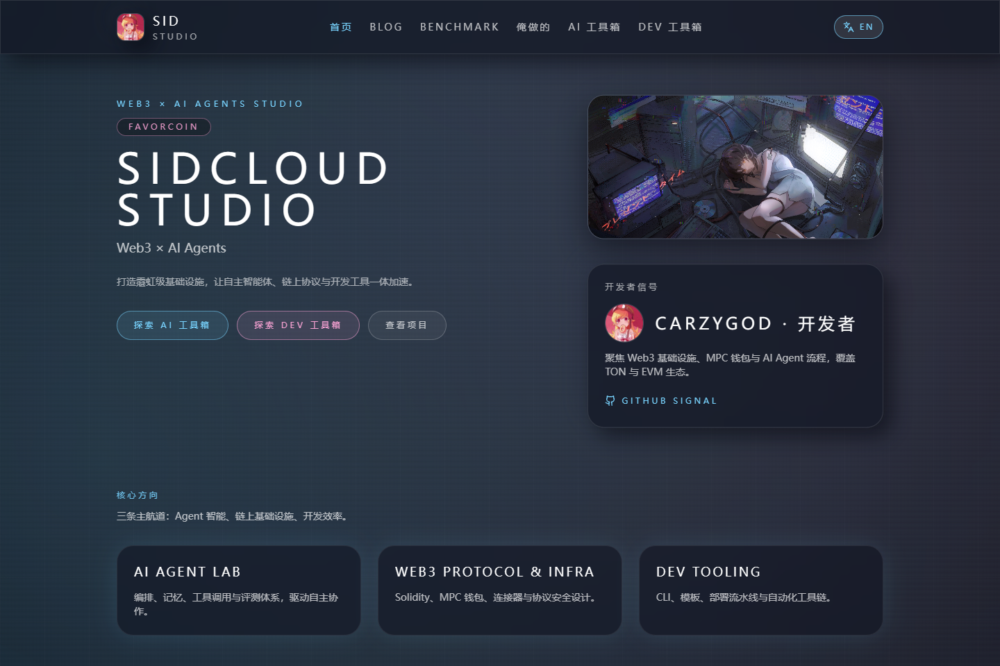
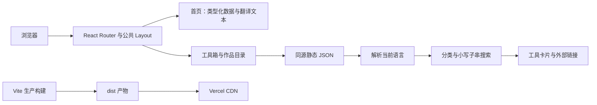

# sidcloud Studio 官网

[English](README.md) · [简体中文](README.zh-CN.md) · [线上官网](https://www.sidcloud.cn/) · [现任 GitHub](https://github.com/wikigsroom)

这是 sidcloud Studio 官网的正式维护仓库，包含中英双语工作室展示、项目作品、AI 工具导航、自研应用目录，以及可复用的 Vercel 部署流程、文档与演示素材。



## 实际使用演示


[桌面完整录屏 MP4](docs/media/desktop-tour.mp4) · [手机完整录屏 MP4](docs/media/mobile-tour.mp4) · [全部截图与录屏](docs/media/README.md)

素材来自本地生产构建的真实浏览器操作。文档录制时屏蔽外部 Live2D 装饰组件和 Google Fonts，字体使用 CSS 中的系统回退；GIF 做了加速。这些处理不改变官网代码。详见[媒体生成说明](docs/zh-CN/media.md)和[素材清单](docs/media/manifest.json)。

## 已实现的内容

| 页面 | 路径 | 使用逻辑 |
| --- | --- | --- |
| 工作室首页 | `/` | 展示工作室介绍、三大方向、六个精选项目、日期动态、图片画廊和开发者信息 |
| AI 工具箱 | `/aitoolbox` | 76 条工具、三个分类，支持文本搜索、分类筛选和访问外部网站 |
| 自研作品 My Box | `/mybox` | 18 个作品、十个分类，包含双语简介、标签、搜索和外链 |
| 开发工具箱 | `/devtoolbox` | 五条演示内容和五个分类；目前使用占位链接 |
| 未匹配路径 | `*` | 客户端“Signal Lost”页面，可返回首页 |
| 公共导航与页脚 | 所有页面 | 中英文切换、语言记忆、Telegram、旧 GitHub 封禁标注和现任仓库入口 |

页脚按要求保留带删除线的 `Github(惨遭封禁)`，右侧放置 GitHub 图标和 `现任仓库`，指向 `https://github.com/wikigsroom`。

项目采用静态 React 应用方案。目录内容直接在源码文件中维护，修改后重新构建发布。博客和个人研究资料库另行维护。

## 具体架构与运行逻辑



`main.tsx` 初始化 React、路由、SEO 元信息和语言系统；`App.tsx` 负责页面路由与切换动画；`Layout.tsx` 提供公共导航、页脚及装饰组件。AI 工具箱读取 `/main.json`，作品目录读取 `/myapp.json`，加载后的分类和搜索都在浏览器内完成，不依赖搜索服务。

语言检测先读取 `localStorage["sidcloud-lang"]`，再读取浏览器语言。界面支持 `en-US`、`zh-CN`，默认回退到英文。目录文本按“当前语言 → 英文 → 中文”选择。已有但损坏的翻译仍是非空字符串，不会触发回退；此类存量问题在[已知问题](docs/zh-CN/known-issues.md)中如实记录。

## 本地运行

使用原生 Node.js 和 npm。本地检查与 CI 使用 Node 22，当前 Vercel 项目使用 Node 24。运行网站不需要应用密钥或 `.env`。

```sh
git clone git@github.com:wikigsroom/website.git
cd website
npm ci
npm run dev
```

打开 Vite 输出的本地网址。检查及预览生产版本：

```sh
npm run check
npm run preview
```

| 命令 | 功能 |
| --- | --- |
| `npm run dev` | 启动 Vite 开发服务 |
| `npm run build` | 将静态生产产物写入 `dist/` |
| `npm run typecheck` | 检查 TypeScript，不生成额外文件 |
| `npm run lint` | 检查应用源码，排除生成后的打包文件 |
| `npm run check:content` | 检查目录结构、重复 ID、链接格式、图片文件和构建输出配置 |
| `npm run check` | 依次执行类型检查、Lint、内容检查和生产构建 |
| `npm run docs:media` | 构建、截取页面、录制桌面/手机操作并生成 MP4 和 GIF |
| `npm run docs:check` | 检查文档本地链接、素材哈希/大小及截图对应的源码指纹 |
| `npm run release:check` | 执行完整应用与文档检查 |

## 内容应该修改在哪里

| 修改目标 | 对应文件 |
| --- | --- |
| 导航、旧/新 GitHub、Telegram | [`src/data/site.ts`](src/data/site.ts) |
| 首页精选项目 | [`src/data/projects.ts`](src/data/projects.ts) |
| 人物信息翻译键和身份信息 | [`src/data/founder.ts`](src/data/founder.ts) |
| 最新动态日期 | [`src/data/updates.ts`](src/data/updates.ts) |
| 两种界面的文本 | [`src/i18n/translations.ts`](src/i18n/translations.ts) |
| 实际生效的 AI 工具目录 | [`public/main.json`](public/main.json) |
| 实际生效的自研作品目录 | [`public/myapp.json`](public/myapp.json) |
| 开发工具箱演示条目 | [`src/data/toolbox.ts`](src/data/toolbox.ts) |
| 图片映射及本地素材 | [`src/data/assets.ts`](src/data/assets.ts)、[`public/`](public/) |
| 页脚展示形式 | [`src/components/Layout.tsx`](src/components/Layout.tsx) |
| 主题和动效 | [`tailwind.config.ts`](tailwind.config.ts)、[`src/index.css`](src/index.css) |

条目 ID 应保持稳定且唯一。目录条目包含双语名称、分类、来源方、网站、简介、标签和资料来源。完整字段与示例见[内容维护](docs/zh-CN/content.md)。`toolbox.ts` 中保留的旧 `aiTools` 数组不是当前 AI 工具箱的数据源。

## 使用独立 Vercel 账户部署

现有正式项目名为 `sidcloud`，所属团队为 `carzygodwu-2768s-projects`。预期账户、团队/项目 ID 和固定 CLI 版本记录在 [`operations/vercel-project.json`](operations/vercel-project.json)；这些是项目定位信息，不是登录凭证。

在原生 Windows PowerShell 中执行：

```powershell
pwsh -File scripts/vercel.ps1 Init
pwsh -File scripts/vercel.ps1 Login
pwsh -File scripts/vercel.ps1 Status
pwsh -File scripts/vercel.ps1 Preview
pwsh -File scripts/vercel.ps1 Production
```

`Init` 生成已忽略的本地项目关联文件；`Login` 输出设备授权链接，在隐私窗口登录官网所属账户。已有隔离登录状态时，直接使用 `Status`，无需重复登录。

脚本每次都固定使用 `--global-config` 指向 `%LOCALAPPDATA%\sidcloud\vercel-profile`，强制使用独立文件凭证，临时清理继承的 Token/项目环境变量，并核验账户名和目标项目。操作结束后恢复进程环境。凭证位于仓库与上传目录之外，Preview 和 Production 均先运行 `release:check`。

[`vercel.json`](vercel.json) 明确指定 Vite、`npm run build` 和 `dist/`，避免项目历史默认配置选错输出目录。GitHub 推送与 Vercel 部署是两个操作；当前仓库没有设置“每次 push 自动发布正式站”。详细操作、恢复步骤见[部署与更新](docs/zh-CN/operations.md)。

域名验证文件维护在 `public/`，构建时原样复制到产物根目录。域名验证仍依赖这些文件时，应持续保留：

| 公开验证地址 | 完整正文 |
| --- | --- |
| [`/17df1b98016e4dce51cf8d4080665747.txt`](https://www.sidcloud.cn/17df1b98016e4dce51cf8d4080665747.txt) | `ce49460b29a0a3d3fbf87ef530c8954f96e0258c` |
| [`/b8261e943cb1290db1a42a32c0ee9566.txt`](https://www.sidcloud.cn/b8261e943cb1290db1a42a32c0ee9566.txt) | `ec8ff0c82edb079d74fc8fc19d6c709828a0650a` |

源码位置与验证步骤见[部署与更新](docs/zh-CN/operations.md)，发布记录见[首次验证文件发布](docs/releases/2026-10-29-domain-verification.md)与[本次新增文件发布](docs/releases/2026-10-29-domain-verification-b8261e94.md)。

## 截图、录屏和 GIF

生成媒体还需要 Playwright Chromium，以及 `PATH` 上的原生 `ffmpeg`、`ffprobe`：

```sh
npx playwright install chromium ffmpeg
npm run docs:media
npm run docs:check
```

可通过 `PLAYWRIGHT_CHROMIUM_EXECUTABLE_PATH` 使用已安装的 Chrome，通过 `FFMPEG_PATH`、`FFPROBE_PATH` 指定编解码工具。素材覆盖桌面与手机、两种首页语言、工具页、搜索、页脚和客户端 404，并包含两段 MP4、两张动态 GIF。临时 WebM 位于已忽略的 `docs/media/.raw/`。

## 后续更新与同步约定

每次修改都应：更新对应源码/数据，在 [CHANGELOG.md](CHANGELOG.md) 中补充带日期的说明，同步两种语言的相关文档，界面源码变化时重新生成媒体，执行 `npm run release:check`，检查暂存差异后提交并推送到 `origin/main`。发布线上网站时使用隔离账户脚本，并在发布说明中记录地址与验证结果。

CI 在 push 和 PR 时执行相同检查。页面源码指纹可以发现过期素材，素材哈希可以发现缺失或未登记的截图/录屏。[CONTRIBUTING.md](CONTRIBUTING.md) 和 [AGENTS.md](AGENTS.md) 明确保存了这一维护规则。

## 文档导航

| 主题 | English | 简体中文 |
| --- | --- | --- |
| 系统结构与页面运行逻辑 | [Architecture](docs/en/architecture.md) | [架构与运行逻辑](docs/zh-CN/architecture.md) |
| 字段结构与内容维护 | [Content](docs/en/content.md) | [内容维护](docs/zh-CN/content.md) |
| 账户隔离、部署与发布同步 | [Operations](docs/en/operations.md) | [部署与更新](docs/zh-CN/operations.md) |
| 截图、录屏和 GIF 复现 | [Media](docs/en/media.md) | [媒体生成](docs/zh-CN/media.md) |
| 现有边界和待处理项 | [Known issues](docs/en/known-issues.md) | [已知问题](docs/zh-CN/known-issues.md) |

[首次仓库发布说明](docs/releases/2026-10-28.md) · [全部媒体索引](docs/media/README.md)
