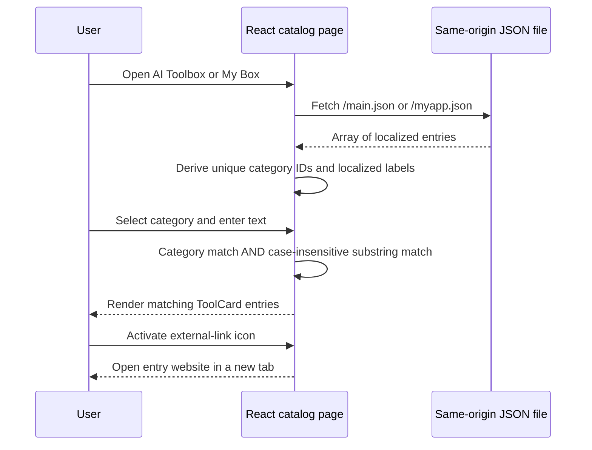

# Architecture and runtime behavior

[README](../../README.md) · [简体中文](../zh-CN/architecture.md)

## System boundary

The website is a static single-page application. React 18 renders the UI, TypeScript defines the component/data contracts, React Router 6 handles navigation, i18next handles translations, Tailwind CSS provides styling, and Framer Motion animates page transitions and cards. Vite 5 builds the application into `dist/` for Vercel.

The application reads public JSON and local images; it has no application server, database, user login, payment flow or administrative content editor. Vercel OAuth belongs to deployment tooling on the maintainer's machine and never enters browser code. The separately maintained blog and private research workspace are outside this repository.

## Startup and page composition

1. [`index.html`](../../index.html) loads [`src/main.tsx`](../../src/main.tsx).
2. The entry point imports global CSS and initializes i18next, `HelmetProvider` and `BrowserRouter` around `App`.
3. [`App.tsx`](../../src/App.tsx) selects a route. `AnimatePresence` and `PageTransition` animate route changes.
4. [`Layout.tsx`](../../src/components/Layout.tsx) supplies shared desktop/mobile navigation, the language button, a page `Outlet`, footer and external Live2D widget.
5. Each page renders its content and passes translated SEO keys to [`Seo.tsx`](../../src/components/Seo.tsx), which updates title, description and Open Graph title/description in the browser.

| Route | Component | Content source |
| --- | --- | --- |
| `/` | `Home` | `src/data/site.ts`, `projects.ts`, `founder.ts`, `updates.ts`, `assets.ts` and translation keys |
| `/aitoolbox` | `AiToolbox` | `public/main.json`, fetched as `/main.json` |
| `/mybox` | `MyBox` | `public/myapp.json`, fetched as `/myapp.json` |
| `/devtoolbox` | `DevToolbox` | Developer entries/categories in `src/data/toolbox.ts` and UI translations |
| Any other client path | `NotFound` | Translated “Signal Lost” page with a home link |

The homepage contains a hero, three studio focus areas, six featured projects, dated update cards, image gallery and builder information. Its content is a showcase; project links navigate to external services rather than implementing those services here.

The shared navigation reads `siteConfig.nav` in order. Immediately after Home, BLOG opens `https://blog.sidcloud.cn/` and Benchmark opens `https://benchmark.sidcloud.cn/`. Entries marked `external: true` render native anchors with `target="_blank"` and `rel="noopener noreferrer"`; internal entries use React Router `NavLink`. Both locales retain the BLOG/Benchmark labels. Below 1024 px the navigation appears in a wrapping row beneath the brand and language control; wider screens use the desktop row.

## Catalog loading, filtering and outbound links

Each mount fetches the relevant JSON once. Successful array responses enter component state. A failed request, invalid JSON or non-array payload results in an empty array; the current UI has no separate network error or loading message. Filtering uses `useMemo` and updates immediately as state changes.

The search corpus joins the currently localized name, description, vendor, category label and tag labels, converts it to lowercase and applies `includes(query.toLowerCase())`. Category filtering compares stable category IDs, and both conditions must match. Search is a literal substring search without fuzzy ranking, pagination or a remote search API. Whitespace is not trimmed automatically. Switching languages changes the search corpus; route changes remount pages and reset their local filters.

Categories are derived from the loaded data in first-seen order. “All” bypasses the category restriction. `ToolCard` renders the name, summary, tags, category, vendor and an external icon. The destination is `website`, then the first `sources` URL, then the existing `https://example.com` fallback. The current content checker requires a valid HTTP(S) `website` for both maintained JSON catalogs.

Dev Toolbox uses the same category-plus-text interaction with its bundled demonstration array. Its search joins translated name, summary, scenario and tags, and compares the selected category's translation key. It does not fetch catalog JSON; its five external links currently point to placeholders.

## Localization

[`src/i18n/index.ts`](../../src/i18n/index.ts) detects `localStorage["sidcloud-lang"]` before browser language and caches the selected language. Supported locales are `en-US` and `zh-CN`, with English fallback. The header button switches between them.

UI copy uses [`translations.ts`](../../src/i18n/translations.ts). Catalog text uses [`localizedToolbox.ts`](../../src/lib/localizedToolbox.ts): a string is returned directly; a localized object resolves the selected language, then English, then Chinese, then an empty string. The helper recognizes exactly `zh-CN` as Chinese. Damaged but nonempty text does not trigger fallback.

The footer intentionally keeps the user's literal Chinese labels in both locales: the former link displays struck-through `Github(惨遭封禁)` and the adjacent GitHub icon plus `现任仓库` opens `https://github.com/wikigsroom`. Other profile/project GitHub links are independently configured.

## Visual and hosting behavior

[`src/index.css`](../../src/index.css) and [`tailwind.config.ts`](../../tailwind.config.ts) define the dark background, cyan/pink highlights, glass panels, gradients and scanline treatment. Local image URLs are mapped in [`assets.ts`](../../src/data/assets.ts). The header uses a desktop navigation row and a separate mobile row. Homepage sections use scroll-triggered animation; the media script scrolls the full document before capturing the complete homepage.

Google Fonts and Live2D are external runtime dependencies. They are excluded only in documentation capture to avoid network-dependent stalls and widget failures; the shipped application still requests them.

Vercel receives source and runs `npm run build`; [`vercel.json`](../../vercel.json) explicitly sets framework `vite` and output `dist`. JSON is copied from `public/` into the deployment root. Absolute asset and fetch paths assume hosting at the domain root, rather than a nested subdirectory.

Client routing and server routing are distinct. Current configuration has no SPA rewrite. The existing deployment audit found direct requests/refreshes to internal pages returning HTTP 404 even though navigation from the homepage works. The local Vite preview used for media falls back to the SPA. See [known issues](known-issues.md) before treating local captures as production route validation.

## Repository maintenance controls

- `check-content.mjs` validates catalog entries, image references and Vercel output settings.
- `check-docs.mjs` checks local documentation links and committed media against their manifest.
- The visual source digest covers `src/`, `public/`, `index.html`, `tailwind.config.ts` and `vite.config.ts`. Text CRLF/LF differences are normalized for cross-platform checkout consistency.
- Native PowerShell [`vercel.ps1`](../../scripts/vercel.ps1) fixes the isolated account/team/project and runs release checks before deployment.
- CI validates the committed source and evidence; it does not log in to Vercel or deploy automatically.

Continue with [content editing](content.md), [operations](operations.md) or [media generation](media.md).
