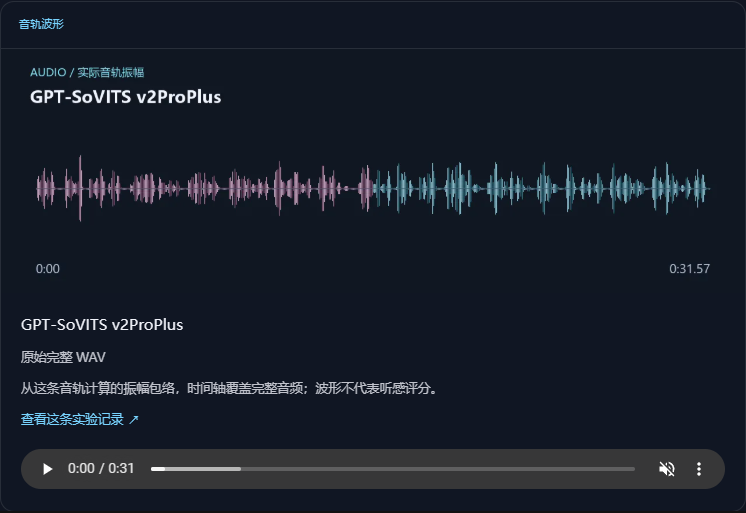

# 页面截图与演示 / Screenshots and demos

[中文 README](../../README.zh-CN.md) · [English README](../../README.md) · [最新更新 / Latest release](../releases/2026-10-30-visual-refresh.md) · [标题更新 / Editorial release](../releases/2026-10-29-editorial-refresh.md)

基于 2026-10-29 冻结测评数据的可视化版本：46 篇栅格封面、103 张正文图，以及原音视频播放、文章导航和逐项记录。截图和演示录制自实际本地生产构建，不是重新运行模型的录像。

Captured from the visual edition built on the frozen 2026-10-29 benchmark data: raster covers for 46 journals, 103 inline figures, original playback, navigation and evidence expansion. The demos show the actual built UI, rather than fresh model execution.

| 文件 / File | 内容 / Content |
| --- | --- |
| [batch-index-desktop.png](benchmark-20261029/batch-index-desktop.png) | 桌面栏目入口 / Desktop batch index |
| [batch-overview-desktop.png](benchmark-20261029/batch-overview-desktop.png) | 46 批、681 项范围 / Batch coverage board |
| [batch-article-desktop.png](benchmark-20261029/batch-article-desktop.png) | 批次文章头部 / Article header |
| [batch-record-desktop.png](benchmark-20261029/batch-record-desktop.png) | 展开的逐项证据 / Expanded evidence |
| [review-batch-desktop.png](benchmark-20261029/review-batch-desktop.png) | 无新增执行的复核批次 / Review batch with no new executions |
| [batch-article-mobile.png](benchmark-20261029/batch-article-mobile.png) | 390px 手机阅读 / Mobile article |
| [batch-record-mobile.png](benchmark-20261029/batch-record-mobile.png) | 历史 TTS 记录 / Historical TTS entry on mobile |
| [batch-gallery-desktop.png](benchmark-20261029/batch-gallery-desktop.png) | 实际视频抽帧与时间点 / Real video frames and timestamps |
| [audio-gallery-desktop.png](benchmark-20261029/audio-gallery-desktop.png) | 完整音轨波形与试听 / Full-track waveform and audio controls |
| [image-gallery-desktop.png](benchmark-20261029/image-gallery-desktop.png) | 实际 3D 网格预览截图 / Actual 3D mesh preview screenshot |
| [illustrated-article-desktop.png](benchmark-20261029/illustrated-article-desktop.png) | 插画封面和文本测评 / Illustration-led reasoning article |
| [batch-gallery-mobile.png](benchmark-20261029/batch-gallery-mobile.png) | 手机上的样片分镜与来源 / Mobile storyboard and source attribution |
| [batch-walkthrough.mp4](benchmark-20261029/batch-walkthrough.mp4) · [GIF](benchmark-20261029/batch-walkthrough.gif) | 桌面栏目到逐项记录 / Desktop navigation and expansion |
| [batch-mobile.mp4](benchmark-20261029/batch-mobile.mp4) · [GIF](benchmark-20261029/batch-mobile.gif) | 手机复核文章 / Mobile review article |
| [verification.json](benchmark-20261029/verification.json) | 46 路由、770 次展开、筛选、阅读和布局检查 / Route, coverage and interaction checks |
| [cross-origin-proof.json](benchmark-20261029/cross-origin-proof.json) | 真实博客域名下的原素材加载验证 / Original media loading from the real blog origin |
| [production-visual-article-desktop.png](benchmark-20261029/production-visual-article-desktop.png) | 2026-10-30 可视化版正式域名截图 / Visual edition on the production domain |
| [可视化版生产验收 / Visual production proof](../releases/2026-10-30-visual-production.json) | 当前部署、构建文件与 46 篇图文测评验收 / Current deployment, exact build files and 46 illustrated journals |
| [production-article-desktop.png](benchmark-20261029/production-article-desktop.png) | 2026-10-29 标题版本历史截图 / Historical editorial release screenshot |
| [标题版生产验收 / Editorial production proof](../releases/2026-10-29-editorial-production.json) | 上一版部署记录 / Previous production release record |





复现 / Reproduce:

```sh
npm run build
npm run docs:media
npm run docs:check
```

需要原生 Chrome、FFmpeg、FFprobe；不使用 Docker/WSL。可用 `PLAYWRIGHT_CHROMIUM_EXECUTABLE_PATH`、`FFMPEG_PATH`、`FFPROBE_PATH` 指定可执行文件。浏览器仅使用脚本自己的临时上下文，不复用个人登录。脚本退出时关闭自己创建的浏览器和预览服务，原始录屏保留在忽略目录 `docs/media/.raw/`。

Requires native Chrome, FFmpeg and FFprobe. On a fresh machine, run `npx playwright-core install ffmpeg` once to install Playwright's native recording helper. 新机器还需以该命令安装原生录制辅助程序。Executable paths can be selected with the environment variables above. The script owns a temporary browser context, closes its browser and preview server on exit, and keeps raw recordings in the ignored directory. Browser verification checks 320/390/768/1440px layouts; no third-party font dependency is needed for captures.

`docs:check` 核对媒体存在、验收通过、资源已关闭，并以规范化换行后的 SHA-256 绑定当前内容与界面，避免代码变了而截图仍旧。上表本地验收媒体来自实际生产构建；两张 `production-*` 截图来自对应版本的正式域名，并有各自的发布验收记录。

`docs:check` checks media presence, passing verification, resource cleanup and a newline-normalized SHA-256 of the content/UI files. Local verification media comes from the production build; both `production-*` screenshots come from the corresponding deployed editions and have separate release proofs.
