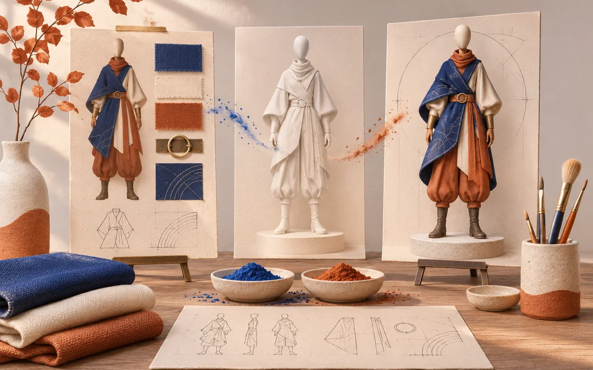
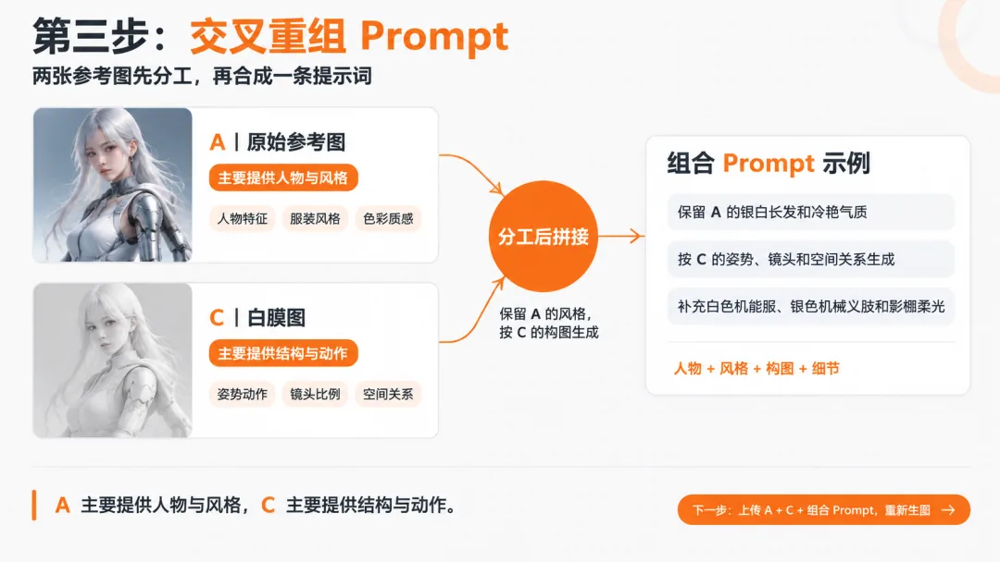
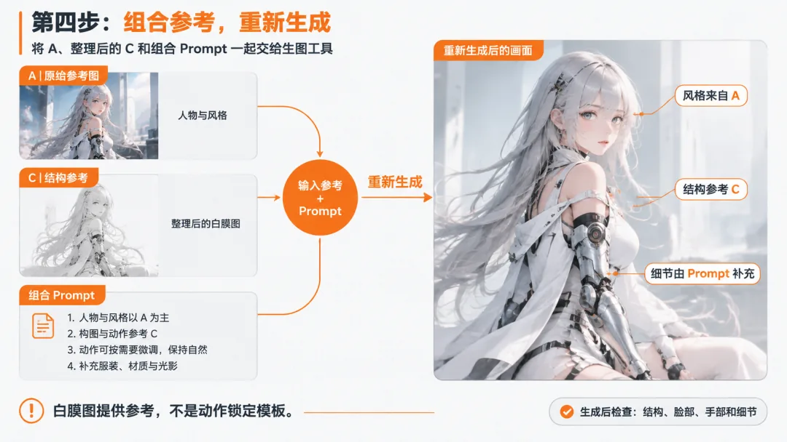

# 图片越改越乱时：把结构和风格拆开重做

用外观参考 A、问题图 B 和结构图 C 重新组织图像编辑，减少反复修补带来的漂移。

原标题：AI生图越修越脏？试试这套“洗图”流程

原文：火玉的田野 / 火玉 · 2026-10-12

本站整理：2026-11-06 · [阅读原文](https://mp.weixin.qq.com/s/-8iEwwOuAP4Aj4zXq5tWQw) · [博客文章](https://blog.sidcloud.cn/#/post/ai-image-repair-structure-style)



gpt-image-2.5-flare 主题插画 · 通过 sub2-image-gen 生成；正文另附原文素材

一张图改到第五轮，往往已经很难说清楚哪里出了问题：最初想保留的脸、姿态、服装和光线，可能在不同轮次里逐渐漂移。原文把修复拆成外观与结构两条线。这个方法的价值在于给每张参考图指定职责，让下一次生成知道该听谁的。本文沿用 A/B/C 编号，整理成可重复查阅的编辑流程。

**先确定参考图的分工**

- A 提供人物与视觉风格，B 用来诊断问题，C 表达经过检查的姿势和空间结构。
- 结构图也可能出错，必须先验收比例、重心与轮廓，再用于生成。
- 局部瑕疵优先局部处理；结构和整体风格已经漂移时，再考虑整图重建。

## 三张图，各自回答一个问题

**A/B/C 参考职责表**

| 输入 | 提供的信息 | 不应直接继承 |
| --- | --- | --- |
| A：干净的外观参考 | 身份、服装、色彩、材质与画风 | 与本次目标无关的姿势 |
| B：当前问题图 | 仍可用的构图，以及需要修正的位置 | 污染纹理、变形与错误比例 |
| C：简化结构图 | 主体位置、动作、镜头、留白和空间关系 | 不必要的材质和复杂装饰 |

这里的白模或“白膜”只是简化结构参考的叫法，并不是一种标准文件格式，也不是严格锁定姿态的控制信号。如果工具只接受一张参考图，可以把外观与结构分阶段输入，或做一块标注清楚的参考板。它们对结果的约束强度仍取决于具体工具。

## 从诊断到重建的四步

- 先诊断 B：把问题分为姿势、身份、材质与局部细节，明确本轮只解决哪一层。
- 由 B 提炼 C：留下需要的构图与轮廓，去掉颜色和复杂纹理，再人工检查结构。
- 从 A 提取具体外观：写清发型、衣服、材质、光源与背景，排除 B 已经出现的错误。
- 用 A 和检查后的 C 重建：先看整体和重心，再看身份、手部、边缘与纹理；只剩小问题时用蒙版处理。



原文流程图：外观参考与结构参考的分工 · 来源：火玉的田野 · [原素材](https://mmbiz.qpic.cn/mmbiz_png/CgI6wDargpAPrsFkTyfHAv1n5ZoG9ORwSC8kFUndKicQkf5YXaGgubbs84E5cVHv6vLgUVnkGHKGauVDvpobN10u1VWLibxSOMMTTOdHVicfIY/640?wx_fmt=png&from=appmsg) · [原文](https://mp.weixin.qq.com/s/-8iEwwOuAP4Aj4zXq5tWQw)

## 把提示词写成输入契约

```txt
整理示例（根据原文方法重新编写）：
目标：重建一张干净的角色概念图。
外观以 A 为准：保留人物特征、服装设计与主色。
结构以已验收的 C 为准：保留站位、身体朝向、镜头和留白。
B 只用于说明问题，不作为纹理来源。
允许修正不自然的手部与身体比例。
先输出一张结构与外观检查样张，再决定是否细化。
```

提示词里最容易混淆的是“保持不变”的对象。与其同时要求完全保留所有参考，不如明确身份听 A、结构听 C、错误不听 B。工具提供图像权重或结构强度时，每轮只调整一项，并保存参数；否则很难判断改善来自提示词还是参考权重。



原文案例：依据整理后的结构重新生成，再检查细节 · 来源：火玉的田野 · [原素材](https://mmbiz.qpic.cn/mmbiz_png/CgI6wDargpCEI4dEP904fZeTX7iaJSE6j7qYL2CqnlSicBLAic26XjkGzwn9pc63CofhsQReiaBO6uWdsoXW22HfKhmMYBbHTd5UicMXD8nEiavpM/640?wx_fmt=png&from=appmsg) · [原文](https://mp.weixin.qq.com/s/-8iEwwOuAP4Aj4zXq5tWQw)

## 出了问题，回到哪一层

**修复路径速查**

| 现象 | 先返回的位置 | 本轮的停止条件 |
| --- | --- | --- |
| 重心或肢体比例不自然 | C 的结构检查 | 缩小画面仍能读出合理动作 |
| 脸和服装逐渐变样 | A 与身份描述 | 与干净外观参考一致 |
| 结构正确但手指有瑕疵 | 局部蒙版或区域重绘 | 修正后周边不新增变化 |
| 整图纹理污染严重 | 干净参考与新一轮重建 | 整体通过后才继续细化 |

## 怎样留下能复用的记录

每轮保留 A、B、C、提示词、模型标识和结果，给被接受的版本单独编号。这样，下次只换服装或调整构图时，不必再从已经改坏的图片开始。这个方案以自己生成或已获授权的素材为前提；原文的“洗图”指图像整理和修复。此处没有把案例表现写成所有编辑模型都能达到的保证。

[关联阅读：结构参考如何帮助三维白模保持比例](https://blog.sidcloud.cn/#/post/eight-view-ai-3d-blockout)

---

基于公开原文独立整理。素材分别注明来源；原文日期与本站整理日期分列。

[返回精读目录](../wechat-reading.md)
