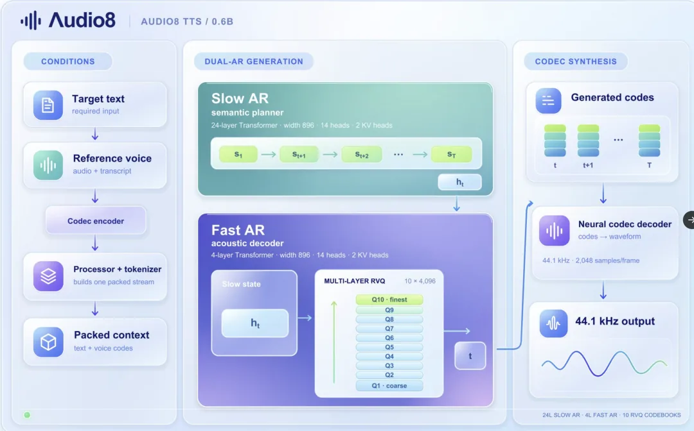
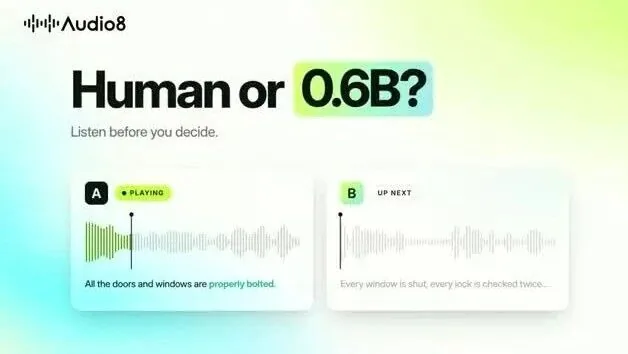

# 小模型也能好好说话：Audio8 的语音部署选择

把 0.6B、0.1B、Preview 与 Realistic Air 分开，先选对版本，再比较听感和运行成本。

原标题：Audio8 TTS： 又一款小而高质量的TTS，支持声音克隆

原文：AI for Frontend / 前端设计大神 · 2026-10-30

本站整理：2026-11-06 · [阅读原文](https://mp.weixin.qq.com/s/NfutJY9UGy6tozL37wMysQ) · [博客文章](https://blog.sidcloud.cn/#/post/audio8-compact-tts)

gpt-image-2.5-flare 主题插画 · 通过 sub2-image-gen 生成；正文另附原文素材

给数字人、阅读器或本地助手接语音时，选模型不能只看试听里最动人的一句话。启动时间、连续朗读、参考音频处理和 CPU 路径，往往更影响每天能不能用。原文介绍 Audio8 TTS 的紧凑路线；这里补上版本对照，避免把不同发布的优点组合成一个实际上并不存在的配置。

**先选版本，再选运行方式**

- 0.6B 的 Realistic Air 偏重真实感与多语言，0.1B 更侧重较小的部署占用。
- Preview 0.6B 的 ONNX INT4 与 0.1B 的 INT8 要分别看；不能推导为 Realistic Air 也有同样导出。
- 参考语音与逐字文本应对应，听感、文本正确率和音色相似度需要分别评价。

## 原文里的名称，怎样对应当前发布

**2026-11-06 核对的版本区别**

| 发布 | 主要定位 | 部署备注 |
| --- | --- | --- |
| Realistic Air · 0.6B | 真实感、韵律与 23 种语言 | 当前官方说明未提供该版 ONNX 导出 |
| Preview · 0.6B | 早期发布，11 种语言 | 有独立的 ONNX INT4 运行方案 |
| Preview · 0.1B | 更轻量，以中英文为主 | 有 CPU / ONNX INT8 方案 |

原文用“Realistic 0.6B”介绍较新分支；整理时官方入口已使用 Audio8-TTS-Realistic-Air。后续下载最好保存完整模型 ID 和版本信息。原文提到的 Mac 内存用量及 0.1B 占用，是特定运行环境的观察，不宜直接拿来规划所有平台的资源。

Audio8 原文架构图：语义与声学生成分层 · 来源：AI for Frontend · [原素材](https://mmbiz.qpic.cn/mmbiz_png/p5aKbB9nc5mRfw6R5cGbELn5Lpa9phccEMr2u6ac5CPZwd1zVB84PxZ6cKTdFEZGSicxJhvl4c09LEU46qoLGHfg7YA9ficj0fqJgphtiaAKnU/640?wx_fmt=png&from=appmsg) · [原文](https://mp.weixin.qq.com/s/NfutJY9UGy6tozL37wMysQ)

## 一次有参考价值的试听怎么做

- 固定一组中文、英文、数字、缩写与长句，先观察有没有漏字、重复或异常停顿。
- 为音色克隆准备干净的授权参考片段，参考文本与实际发音逐字对应。
- 同一组文本分别保存首次启动和预热后的耗时，再记录首段音频等待及总生成时间。
- 把主观听感、内容错误、音色相似和内存峰值分别记录，保留失败样例。

原文 Audio8 TTS 语音演示 · 来源：AI for Frontend · [在微信原文查看视频](https://mp.weixin.qq.com/s/NfutJY9UGy6tozL37wMysQ)。此图为预览封面。

## 听感与评测数字要分开读

官方目前同时提供多组错误率和相似度数据，并说明它们并不直接衡量语音真实感。短句读对了，仍可能缺少合适的语气；声线相似，也可能在长段落里变得不稳定。原文与大模型的对比适合作为选题线索，不能替代同一文本、同一配置下的个人试听。

**按用途选择首次实验**

| 用途 | 优先看什么 | 先留的结果 |
| --- | --- | --- |
| 本地助手 | 首段等待、连续请求、服务恢复 | 短句响应与日志 |
| 文章配音 | 长句韵律、段落衔接、漏读 | 完整段落的 WAV |
| 授权角色声线 | 身份稳定与情绪变化 | 固定参考下的多段试听 |
| CPU 设备 | 完整运行栈的内存与实时率 | 指定 ONNX 版本及硬件记录 |

## 值得保留的判断

Audio8 适合进入小规模语音选型表，尤其是希望减少模型体积、保留本地控制的场景。选择时先写清楚语言和设备，再决定是否需要较新的多语言分支。代码、0.6B 发布和 0.1B 权重的许可入口也应分别保留。本文是资料整理与版本核对，没有把原文的资源占用或听感结论当作本次实测。

## 官方模型、试听与部署文档

[Audio8 官方仓库：各版本、ONNX 与许可入口](https://github.com/Edge0-AI/Audio8_TTS)

[Realistic Air 官方试听页](https://edge0-ai.github.io/Audio8_TTS/realistic-0.6b/)

[关联阅读：语音怎样驱动一个二维角色](https://blog.sidcloud.cn/#/post/mesh-avatar-studio-living-illustration)

---

基于公开原文独立整理。素材分别注明来源；原文日期与本站整理日期分列。

[返回精读目录](../wechat-reading.md)
