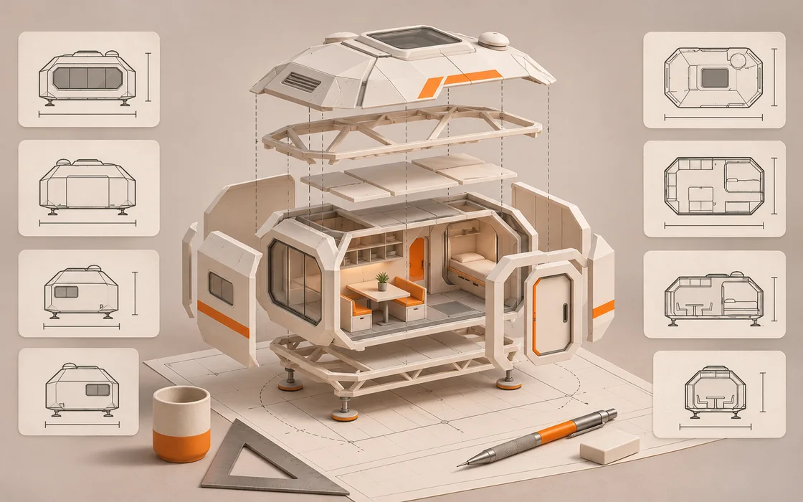
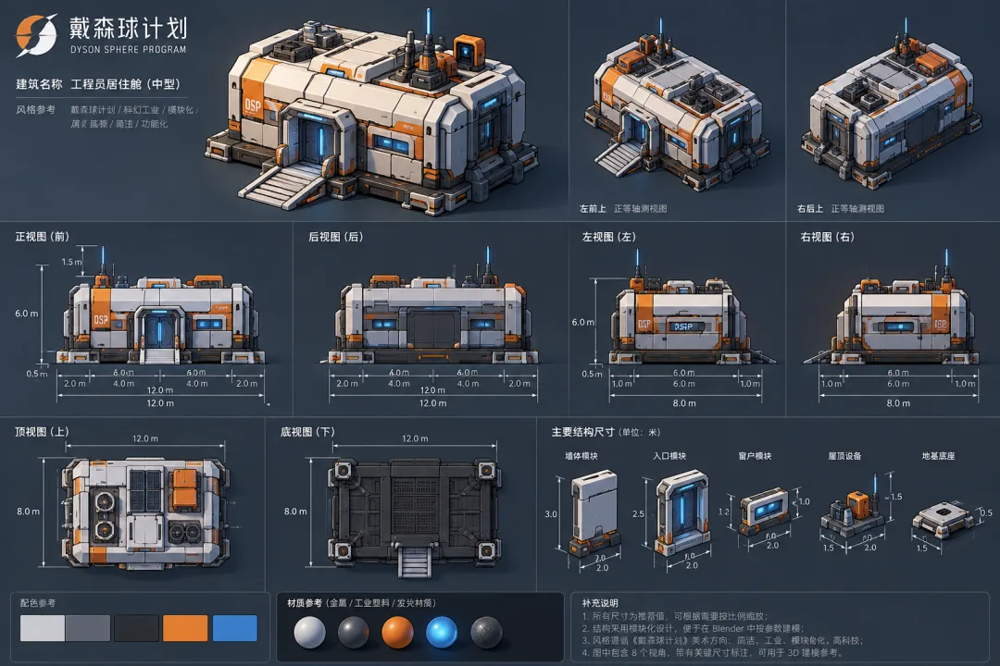
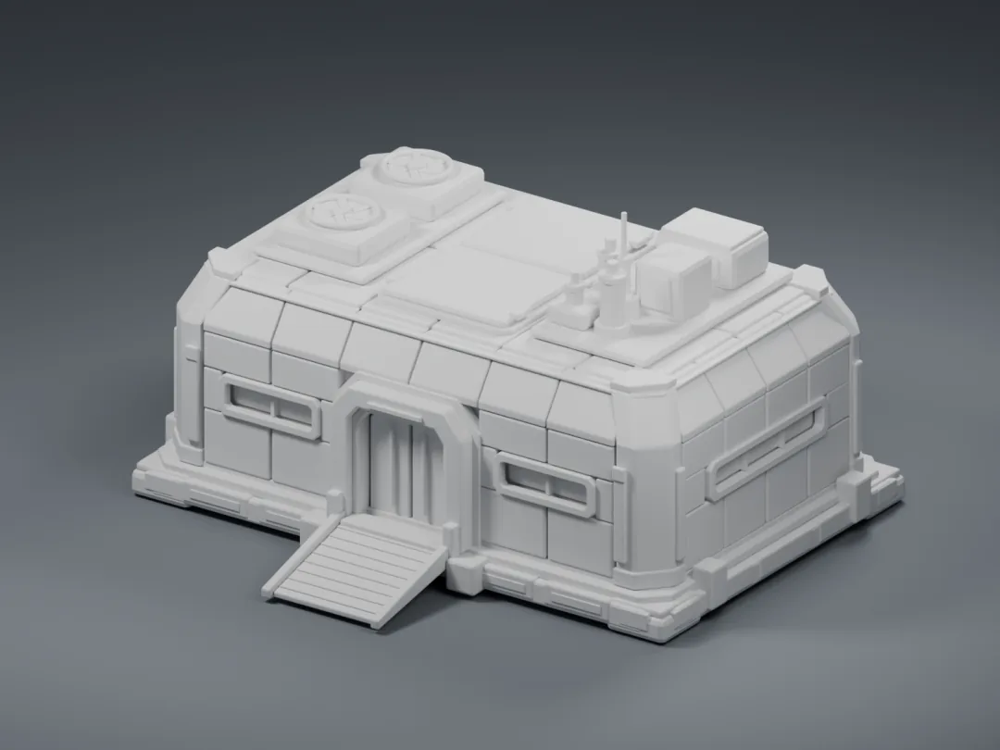
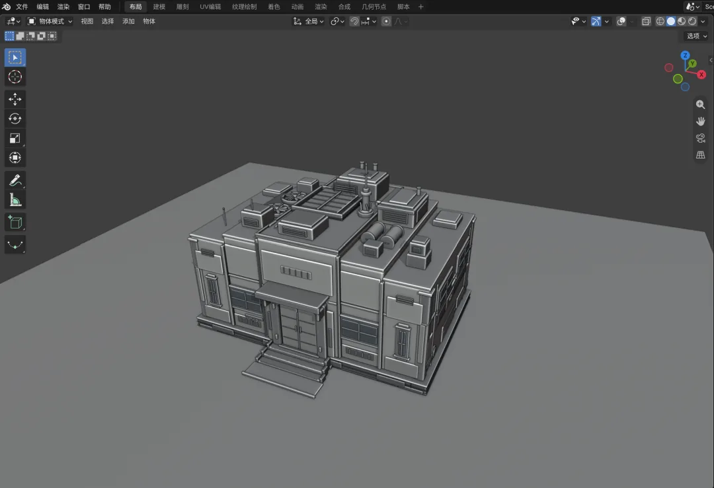
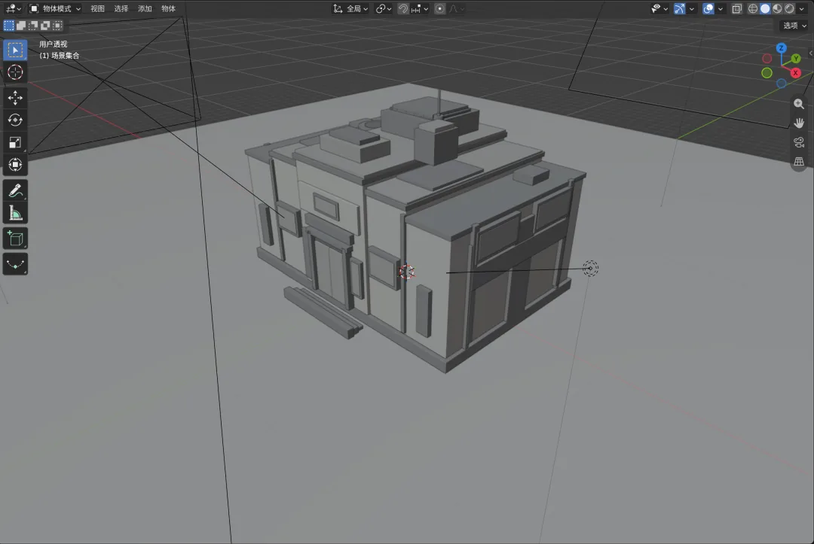
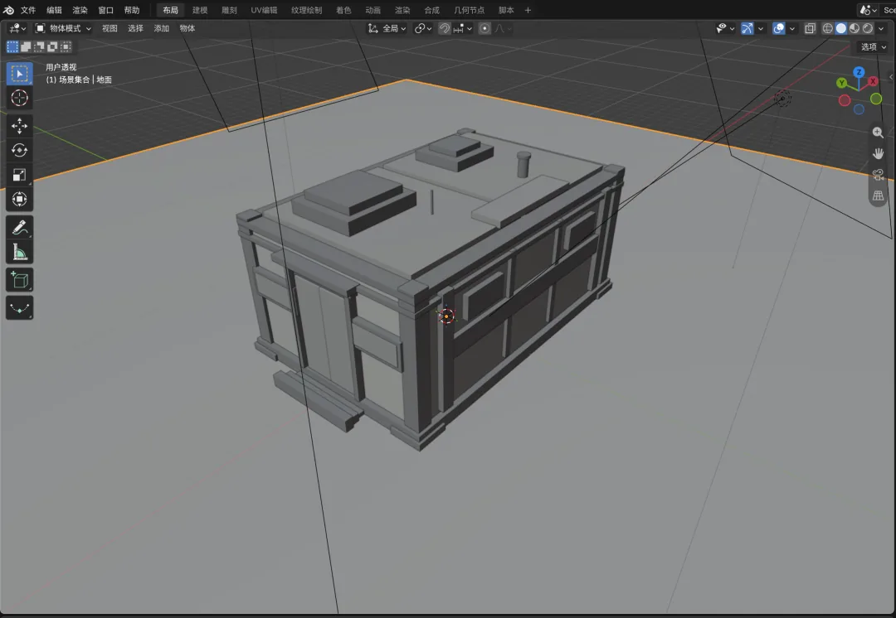
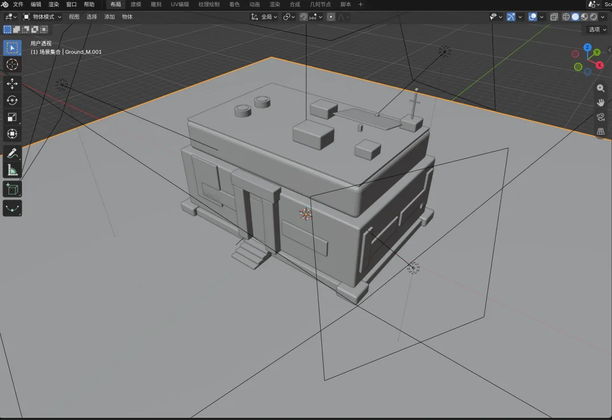
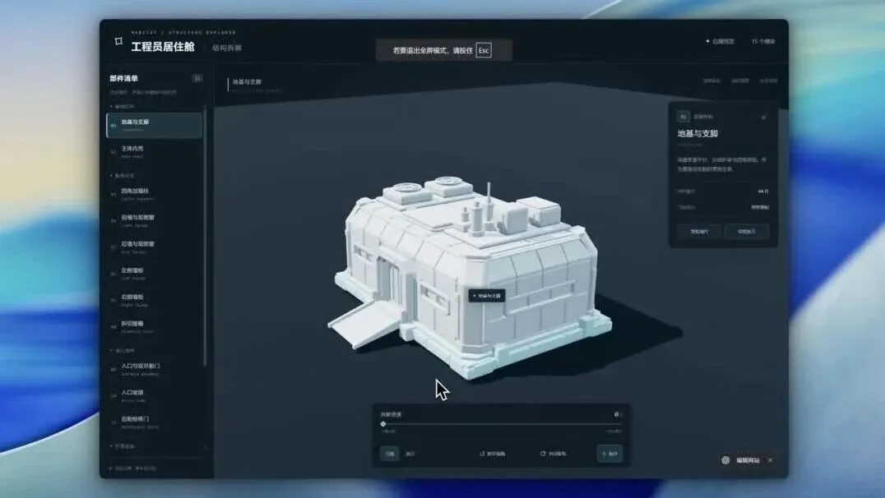

# 先给图纸，再让 AI 建模：八视角白模实验

一座科幻居住舱的参考板、五组结果与网页拆解，说明明确几何约束比反复许愿更有效。

原标题：AI 建模实测：一张八视角参考图，让 ChatGPT 和 DeepSeek-4.1-Flash 替我搭出 3D 白模

原文：亦暖筑序 · 2026-10-27

本站整理：2026-11-06 · [阅读原文](https://mp.weixin.qq.com/s/4Cq7hM92Bk8tug1OLhihyw) · [博客文章](https://blog.sidcloud.cn/#/post/eight-view-ai-3d-blockout)

gpt-image-2.5-flare 主题插画 · 通过 sub2-image-gen 生成；正文另附原文素材

这篇原文是一份具体的个人制作记录：作者想做一个能旋转、能拆解的科幻居住舱，先尝试直接对话建模，再改用八视角图纸约束白模。最有价值的地方是留下了参考板和多组结果，可以观察同一目标怎样在不同工具环境中发生变化。这里保留这些画面，并将流程整理为建模前后的检查表。

**三个值得留下的经验**

- 把网页交互和模型几何分开验收，能转动的页面不代表模型已还原正确。
- 参考图应表达一致的正交关系和尺寸，多角度图片本身也需要检查。
- 原文五组结果是粗比较，不能据此给模型排通用名次。

## 先决定要的是什么模型

**两条建模路径的适用范围**

| 路径 | 适合的目标 | 先检查什么 |
| --- | --- | --- |
| 专门的图生 3D 平台 | 需要网格与材质的角色或物件 | 主体是否唯一、拓扑和贴图是否可用 |
| 参考板 + 代码白模 | 建筑、舱体、机械等硬表面原型 | 比例、构件关系和层级是否准确 |

原文还记录了一个容易忽略的输入问题：把角色三视图直接放进只识别单主体的图生模型，可能得到三个角色。多视角参考能否合并理解，取决于工具的输入约定。开始时先确认它接受多图条件、单张拼图，还是只能接收一个主体，能省下不少无效生成。

## 图纸里应有哪些确定的信息

作者提供给模型的八视角参考板，含尺寸与配色 · 来源：亦暖筑序 · [原素材](https://mmbiz.qpic.cn/sz_mmbiz_png/uYSwaSduJuJMibZSviaV2h9x8ricNx7iaCkLArjXPgLUCib0WrRjL5DmHc0aictCqFRHxe8BzOzqMdialbtnSSh9UwuM4wajzMkIFbbgVY0WFwibQEE/640?wx_fmt=png&from=appmsg) · [原文](https://mp.weixin.qq.com/s/4Cq7hM92Bk8tug1OLhihyw)

- 至少说明主体用途、整体长宽高，以及门、台阶、屋顶设备等主要构件的位置。
- 正交视图和轴测图应互相对应；原文描述采用六个面向视图加两个轴测图，不必把“八视角”理解为固定标准。
- 标注参考的配色和风格，但白模阶段先验收几何，材质放到后面。
- 生成参考板后先检查各视图的开窗、比例和构件数量是否一致，避免把图纸冲突交给模型猜。

## 五组结果保留了哪些差异

**原文作者的观察，非独立模型排名**

| 作者标注的模型 / 平台 | 作者观察 | 比较限制 |
| --- | --- | --- |
| GPT-6 Astra / ChatGPT / Ultra | 整体与屋顶、门窗、台阶较接近参考 | 仅保留作者的界面标识与案例观察 |
| DeepSeek-4.1-Flash / Harness / 高 | 管线、通风与外挂标识较完整 | 环境与提示过程未被统一控制 |
| DeepSeek-4.1-Flash / WorkBuddy / 极高 | 门窗层次较多，也出现额外侧窗 | 细节增多不等于还原更准 |
| DeepSeek-4.1-Flash / WorkBuddy / 高 | 主要体块成立，细节较少 | 与极高档位的输出不能直接推导因果 |
| GLM-5.3-Flash / Zcode / 高 | 构件存在，但整体偏矮胖 | 视角与缩放不完全一致 |

作者标注为 ChatGPT / GPT-6 Astra / Ultra 的白模结果 · 来源：亦暖筑序 · [原素材](https://mmbiz.qpic.cn/mmbiz_png/uYSwaSduJuJkUx5CCxIHZiaE3GlRicTfPx7ACLibYIubibxAbbUicahvZibicNVMgFvLzrg2ad3TfGBEMic7mLkQg0T0jiatriaZzUWokx6BcWYXsQYBU/640?wx_fmt=png&from=appmsg) · [原文](https://mp.weixin.qq.com/s/4Cq7hM92Bk8tug1OLhihyw)

作者标注为 DeepSeek-4.1-Flash / Harness / 高的结果 · 来源：亦暖筑序 · [原素材](https://mmbiz.qpic.cn/sz_mmbiz_png/uYSwaSduJuI6X06R0KPktHfdhFXA6Xv64NZX6ib5gABC21GMiaoB3tWdwZ0mPicQZgR6TE64gljBxbgIOa33e8wyfpib9ZRXmX2FNT6pXmT9LoA/640?wx_fmt=png&from=appmsg) · [原文](https://mp.weixin.qq.com/s/4Cq7hM92Bk8tug1OLhihyw)

作者标注为 DeepSeek-4.1-Flash / WorkBuddy / 极高的结果 · 来源：亦暖筑序 · [原素材](https://mmbiz.qpic.cn/sz_mmbiz_png/uYSwaSduJuL1tGePLiaNw86llHAibdeO2RXxaFYRDtLldftwVn9ozO2zwqibWhlDBVp85yZbRtZMMJcjsEIj01ECTLENOQDlmXM7u3Chvvic5Mw/640?wx_fmt=png&from=appmsg) · [原文](https://mp.weixin.qq.com/s/4Cq7hM92Bk8tug1OLhihyw)

作者标注为 DeepSeek-4.1-Flash / WorkBuddy / 高的结果 · 来源：亦暖筑序 · [原素材](https://mmbiz.qpic.cn/sz_mmbiz_png/uYSwaSduJuIR3RYLmL3vBYD3nyt7WpL7pczYw0g8hPfcZSlVL8gYMe1gVaCypThnUIuDIsyQew0Lb1Hnlp2EcM9mxtztyIPm33odYibdL3vs/640?wx_fmt=png&from=appmsg) · [原文](https://mp.weixin.qq.com/s/4Cq7hM92Bk8tug1OLhihyw)

作者标注为 GLM-5.3-Flash / Zcode / 高的结果 · 来源：亦暖筑序 · [原素材](https://mmbiz.qpic.cn/mmbiz_png/uYSwaSduJuIHgeas65YmA8fXL3bYfPLmRicDABUxLfTaYy1ibrmrdbCTMw8Dq1QtTbDLrhBR0z1Ds3Ytny5qaqEiaMphXmiasibDeKMVsPJhnWico/640?wx_fmt=png&from=appmsg) · [原文](https://mp.weixin.qq.com/s/4Cq7hM92Bk8tug1OLhihyw)

这些名称按原文标注保存，用于对应截图，没有进一步确认每个平台背后的精确服务版本。原作者也说明视角和缩放不统一，因此最稳妥的结论是：参考约束和执行环境值得记录。若要做正式比较，应固定图纸、提示词、观察角度和验收尺寸，并多次运行。

## 把白模装进网页之前

几何验收通过后，再建立可选中的部件层级，给爆炸拆解设置各自的移动方向，并检查复位后是否准确回到原位置。three.js 页面承担展示与交互，不负责替代模型结构判断。若所有物体被合并成一个无层级网格，后续拆解就会变得困难。

原文视频：舱体的交互与爆炸拆解展示 · 来源：亦暖筑序 · [在微信原文查看视频](https://mp.weixin.qq.com/s/4Cq7hM92Bk8tug1OLhihyw)。此图为预览封面。

## 下次复做，留下这份资料包

- 原始目标描述与验收尺寸。
- 已检查一致性的多视角图纸，以及不允许自行添加的构件清单。
- 模型、执行平台、思考档位和实际提示记录。
- 统一镜头下的白模截图、可编辑源文件和网页交互录像。

这条路线适合快速制作硬表面原型和结构讲解。人物、有机形体、精细拓扑与可制造性需要另设流程。这里重组的是原作者案例，没有把五张截图当作本次新执行的 Benchmark 结果。

[关联阅读：二维图像也可以先分离结构与外观](https://blog.sidcloud.cn/#/post/ai-image-repair-structure-style)

---

基于公开原文独立整理。素材分别注明来源；原文日期与本站整理日期分列。

[返回精读目录](../wechat-reading.md)
