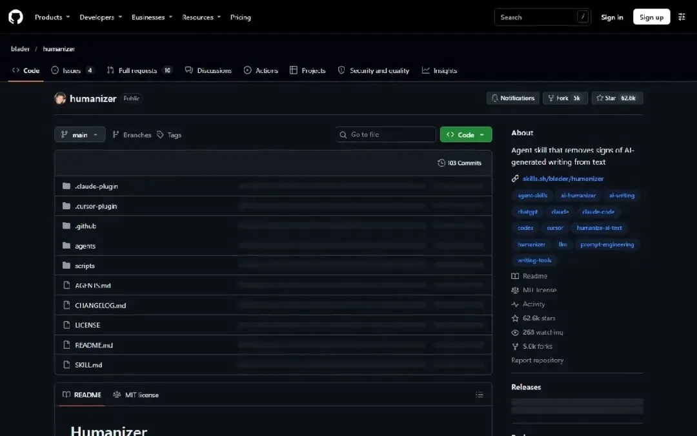
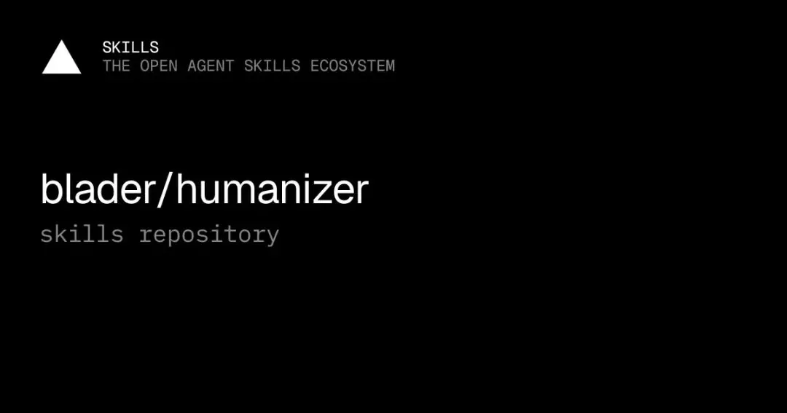

# 让读者愿意读下去：Humanizer 的改稿清单

把空泛起手、重复转折和装饰性表达变成可检查的问题，同时保住事实、引用和作者的语气。

原标题：又一神级Skill，看它如何让你的AI内容充满人味儿

原文：极客AI开源圈 / Bite · 2026-10-31

本站整理：2026-11-06 · [阅读原文](https://mp.weixin.qq.com/s/iAGWmQOcAz1nZt3fsaouGQ) · [博客文章](https://blog.sidcloud.cn/#/post/humanizer-clearer-ai-writing)


gpt-image-2.5-flare 主题插画 · 通过 sub2-image-gen 生成；正文另附原文素材

有些 AI 草稿每句都通顺，却很难让人记住说了什么：开头铺垫很长，段落反复拔高，转折像从同一个模具里出来。原文推荐 Humanizer，把这些现象整理成可查的表达模式。它适合放在事实整理之后、发布之前，当作一次编辑检查，而不是替代作者判断。

**编辑前先守住三条**

- 先保事实、数字与引用，再调整句式；顺口并不等于正确。
- 补具体对象和行动，比机械删除某几个词更有帮助。
- 英文模式清单只能作为中文写作的起点，需要用自己的样稿校准。

## 这份 Skill 解决的是哪一层问题

Humanizer 本身是写作流程与提示规范，不是另一个语言模型。它借鉴维基编辑对 AI 写作特征的整理，列出 26 类模式，并让底层模型找出、改写和再次检查。原文提到的仓库热度和小规模偏好测试，是发布时的观察；它们不等于所有文体、所有语言都能稳定改善的证明。



原文保存的 Humanizer 仓库截图；热度为当时快照 · 来源：极客AI开源圈 · [原素材](https://mmbiz.qpic.cn/sz_mmbiz_jpg/arAE014sTgxcxzOCpIUicuxckIMZeBEuDyz002qrkLuChKtonsYmnQUm1tLufqBfhy9HL7lwuQ6u69MC9icQN2bK2WHoTicOTTyLIW4BL0AcRs/640?wx_fmt=webp&from=appmsg) · [原文](https://mp.weixin.qq.com/s/iAGWmQOcAz1nZt3fsaouGQ)

## 把“像 AI”改成能操作的编辑意见

**中文改稿时可以先检查的项目**

| 现象 | 怎样修改 | 避免的新问题 |
| --- | --- | --- |
| 开头很长才讲到主题 | 提前说清对象、动作与结果 | 删掉必要的上下文 |
| 反复用相同转折句 | 保留真实的因果或直接陈述 | 为了换句式扭曲含义 |
| 形容很多，事实很少 | 加入已有的具体例子与证据 | 为了具体而编造经历或数字 |
| 每段都像结论 | 让段落完成说明、举例或论证 | 把所有句子砍成同样长度 |
| 引用与代码混在改写里 | 明确可改的散文范围 | 改坏来源链接、术语或命令 |

## 适合接在博客整理流程的哪里

- 先完成事实清单与来源对应，标出还没核实的信息。
- 提供两三段自己的写作样稿，说明读者、文体与希望保持的语气。
- 让编辑指出具体句子的问题，给出改写理由，再比较改前改后含义。
- 最后逐项核对名称、数字、日期、链接和不确定性，确认没有把猜测写成事实。

```txt
整理后的编辑任务示例：
读者：以后回看这篇技术笔记的我。
目标：减少空泛铺垫，保留必要解释。
只改正文散文；名称、数字、代码和链接保持准确。
任何新增事实都必须能指向已有来源。
先列出三处最影响理解的问题，再给改稿。
```



原文中的 Humanizer Skills 入口 · 来源：极客AI开源圈 · [原素材](https://mmbiz.qpic.cn/mmbiz_jpg/arAE014sTgwWYePGYfSMiaRE48RdxhvmoZJmw2TawPFTvS1FweoibFnWju9ogzk2v6zPRAlAqicuicIPwGlPcpJUJV2nvaia1JIkF2MUojq9rfMA/640?wx_fmt=webp&from=appmsg) · [原文](https://mp.weixin.qq.com/s/iAGWmQOcAz1nZt3fsaouGQ)

## 中文适配，需要自己补哪一块

中文技术文章有自己的常见问题：一串没有对象的术语、泛化的行业判断、过密的小标题，以及每段末尾都要升华。可以从自己的已发布文章中收集被读者指出的句子，把原因写成规则，再对照真实读者反馈修订。把所有破折号或排比一律删除，反而会损失作者本来有用的节奏。

## 哪些效果不要误读

官方将它定位为面向读者的编辑工具，并明确不以绕过 AI 检测为目标。它也不能把没有研究的稿子变成有证据的文章。更可靠的使用方式，是让它帮忙发现表达问题，再由作者补证据、删掉不必要的判断。本文没有在本机安装该 Skill，保留的是方法与公开入口。

## 清单与测试说明

[官方仓库：26 类模式、使用方式与编辑范围](https://github.com/blader/humanizer)

[原文引用的偏好测试讨论；按其样本与方法解读](https://github.com/blader/humanizer/issues/229)

[关联阅读：清楚的讲稿怎样继续变成白板动画](https://blog.sidcloud.cn/#/post/srt-whiteboard-animation-storytelling)

---

基于公开原文独立整理。素材分别注明来源；原文日期与本站整理日期分列。

[返回精读目录](../wechat-reading.md)
