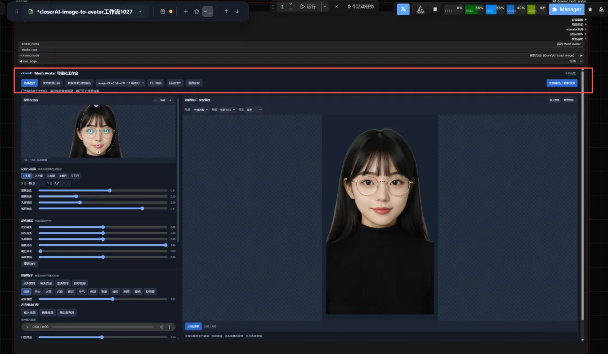
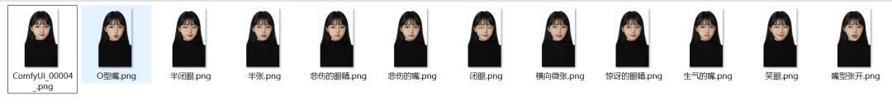
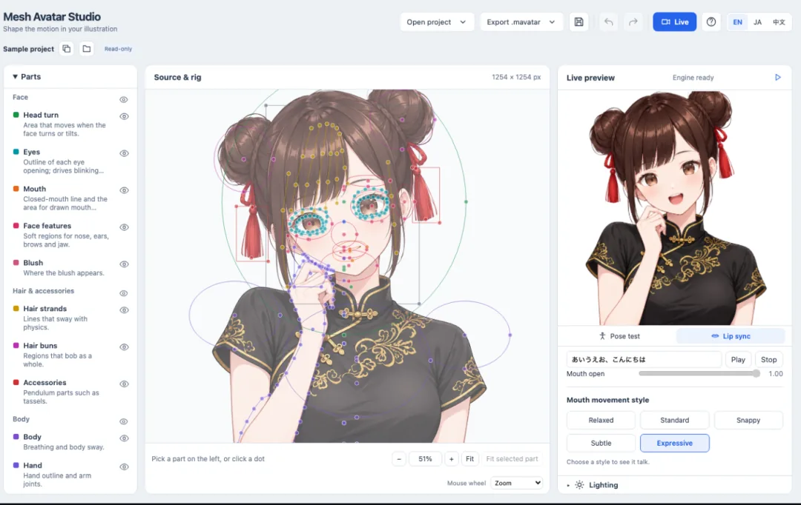
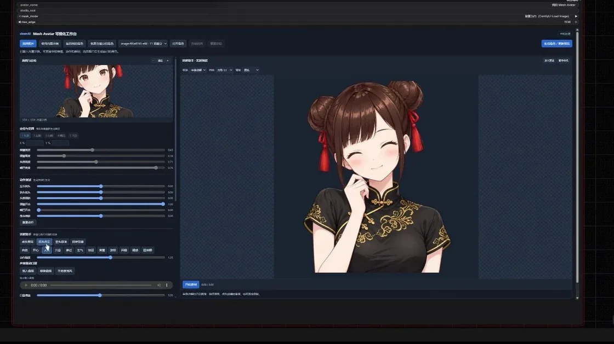
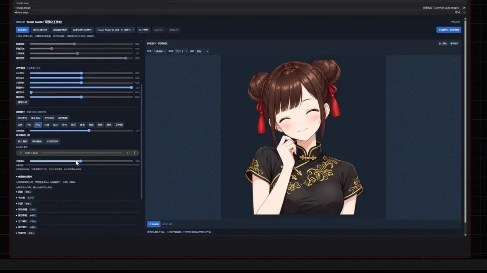
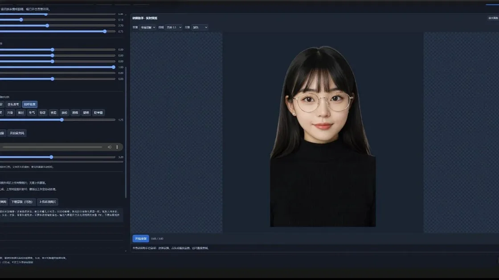

# 让插画成为会回应的角色：Mesh Avatar Studio

从透明底人物、表情图层和网格控制，到语音、摄像头与网页运行时，整理一个二维数字人的制作链路。

原标题：厉害！让一张 AI 角色图变成会说话、会眨眼的动态数字人：Mesh Avatar Studio，轻量级的2D 角色骨骼与网格动画系统！

原文：产品经理逛世界 / JimmyMo · 2026-10-28

本站整理：2026-11-06 · [阅读原文](https://mp.weixin.qq.com/s/uWMdTmCBFuD_iFrOdf2uEA) · [博客文章](https://blog.sidcloud.cn/#/post/mesh-avatar-studio-living-illustration)

gpt-image-2.5-flare 主题插画 · 通过 sub2-image-gen 生成；正文另附原文素材

角色插画可以直接展示，但要眨眼、转头、随语音张嘴，还需要可控制的结构。Mesh Avatar Studio 走的是二维图层与网格动画路线：先建立角色，再在编辑器里调试，最后交给运行时驱动。原文同时展示了作者自己的 ComfyUI 封装，因此阅读时要把上游项目和第三方工作台分别看待。

**先理解它生成的是什么**

- 核心产物是可驱动、可编辑的二维角色资产，适合软件里的持续交互。
- 图层和控制点的准备质量，会直接影响眨眼、口型与转头是否自然。
- 官方编辑器、播放运行时与作者的 ComfyUI 集成属于不同层，维护和功能范围各自核对。

## 一张图片里，还缺哪些可动的部分

静态图只记录一个表情和一个方向。闭眼、不同嘴型、头发背后的空白区域并没有完整信息，需要通过图层准备和差分设计补齐。正面、头肩构图、边缘干净的透明底插画更容易起步；大角度侧脸、复杂遮挡和强烈透视应在后续单独测试。

**角色制作的四层资料**

| 层 | 主要内容 | 验收问题 |
| --- | --- | --- |
| 原始形象 | 透明底图片与角色设计 | 五官清楚，边缘没有残留底色吗 |
| 图层与差分 | 闭眼、口型、头发与遮挡补全 | 切换时是否露底或突然变脸 |
| 网格与控制 | 控制点、变形区域和动作范围 | 转头与张嘴是否拉坏结构 |
| 运行时 | 语音、表情、摄像头与 JavaScript 接口 | 输入变化能否稳定驱动角色 |

原文 Mesh Avatar 编辑器：角色网格与实时预览 · 来源：产品经理逛世界 · [原素材](https://mmbiz.qpic.cn/mmbiz_png/mrjDrTica5PaPZrib7aCSq8UawIsLbeH7AnZefrlRKFuibSg1KABicLr8p60EUicO4B46M5hYL3sSy6xopSQu0sJjS6UOgAR4icbnUaicEtqjibaF4Y/640?wx_fmt=png&from=appmsg) · [原文](https://mp.weixin.qq.com/s/uWMdTmCBFuD_iFrOdf2uEA)

## 从角色图到可用资产

- 准备一张可用的角色插画，先确定静止表情、画幅和透明背景。
- 按项目指南建立图层、轮廓和网格，检查坐标是否与原图一致。
- 在编辑器中测试闭眼、张嘴、头部左右转和倾斜，发现露底时修正图层。
- 准备表情和嘴型差分，检查切换与静止状态是否一致。
- 导出角色并在实际播放页或宿主应用里测试，保存资产版本及默认参数。

作者为角色准备的表情与嘴型差分素材 · 来源：产品经理逛世界 · [原素材](https://mmbiz.qpic.cn/mmbiz_png/mrjDrTica5PYL6XXibVprTibYx0YljppLgOQ9960nibeg1WPsr3dCDMicFujCn3D3jZQmNxAHOCoerFeQRLpbcYNq9lcVibZOqLzFQG3K2FPRuhM4/640?wx_fmt=png&from=appmsg) · [原文](https://mp.weixin.qq.com/s/uWMdTmCBFuD_iFrOdf2uEA)

## 原文里的 ComfyUI 工作台属于哪一层

原作者另做了可视化节点和工作台，方便处理图片与表情素材。这些截图能说明一种集成方式，但不代表上游仓库默认附带相同节点、会员素材或商业软件。后续复用时，可以先用官方示例确认编辑和播放链路，再决定是否需要第三方封装；这样出现问题时也容易判断是哪一层负责。

作者另行封装的 ComfyUI 工作台，属于第三方集成 · 来源：产品经理逛世界 · [原素材](https://mmbiz.qpic.cn/sz_mmbiz_png/mrjDrTica5PaSNyNlmMQ3wHh4CB4vTfbeLhVJ55iaDr6yMJcyzibbAYicJfpv4WE60YM8Weia9PqBqnWGrqX9y0C4rqlnAJzOKq4XCHciaZdictPicg/640?wx_fmt=png&from=appmsg) · [原文](https://mp.weixin.qq.com/s/uWMdTmCBFuD_iFrOdf2uEA)

## 按原文示例观察控制效果

原文视频：预设表情与姿态控制 · 来源：产品经理逛世界 · [在微信原文查看视频](https://mp.weixin.qq.com/s/uWMdTmCBFuD_iFrOdf2uEA)。此图为预览封面。

原文视频：语音驱动口型 · 来源：产品经理逛世界 · [在微信原文查看视频](https://mp.weixin.qq.com/s/uWMdTmCBFuD_iFrOdf2uEA)。此图为预览封面。

原文视频：写实风格角色动画示例 · 来源：产品经理逛世界 · [在微信原文查看视频](https://mp.weixin.qq.com/s/uWMdTmCBFuD_iFrOdf2uEA)。此图为预览封面。

看这些示例时，可以先关心嘴闭合是否完整、说话停止后是否回到静止状态，再看眨眼与转头。口型跟随音量只说明角色在响应声音，不能自动证明每个音素都准确。摄像头驱动还需要检查映射幅度、抖动和无输入时的行为。原文没有展示全部这些条件，因此它们是后续验收建议。

## 适合接到哪些产品里

**接入方向与第一项验证**

| 方向 | 可用的角色能力 | 先做的验证 |
| --- | --- | --- |
| 桌面角色 | 呼吸、眨眼与简单表情 | 长时间运行与无输入状态 |
| 讲解页面 | 语音播放与口型联动 | 暂停、恢复及段落切换 |
| 直播叠层 | 摄像头与麦克风驱动 | 透明输出、设备切换与延迟 |
| 交互应用 | 脚本控制表情和姿态 | 运行接口与资产版本兼容 |

它更适合把一个角色长期放进软件中，而不是追求任意角度的完整三维表演。二维分层也有动作边界，侧转过大时需要额外素材或更复杂的设计。本文保留原作者展示并核对官方入口，没有重新建立角色或声称已测试摄像头链路。

## 上游项目与作者的集成说明

[官方仓库：编辑器、运行时、Agent 指南与当前环境说明](https://github.com/shinshin86/mesh-avatar-studio)

[官方 Player：查看角色播放与实时驱动入口](https://shinshin86.github.io/mesh-avatar-studio/play/)

[原作者另行发布的集成说明](https://aigc.douyoubuy.cn/2026/10/28/422398/)

[关联阅读：为数字人挑选紧凑的语音生成模型](https://blog.sidcloud.cn/#/post/audio8-compact-tts)

---

基于公开原文独立整理。素材分别注明来源；原文日期与本站整理日期分列。

[返回精读目录](../wechat-reading.md)
