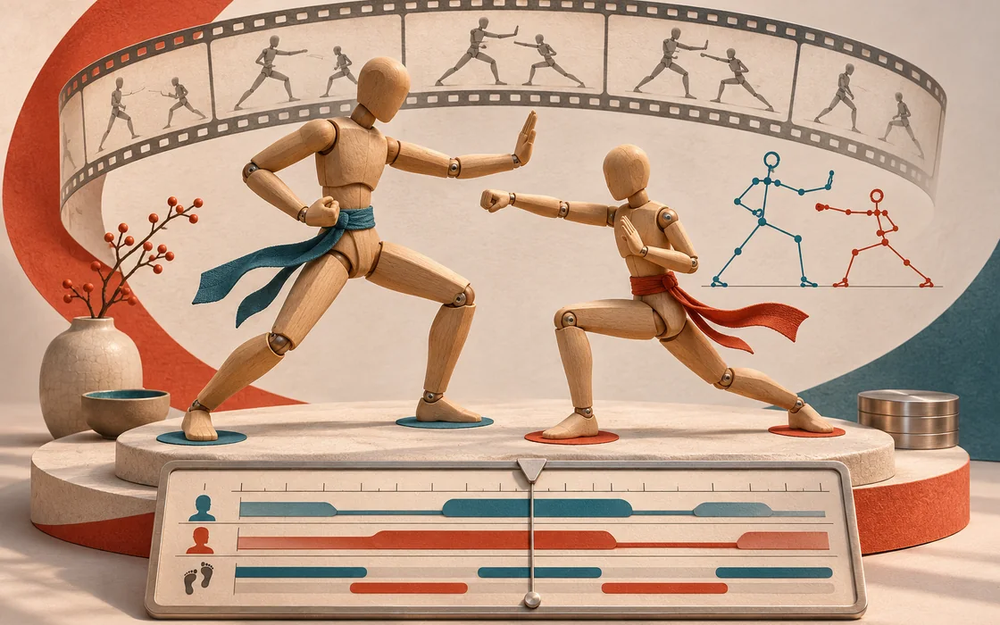
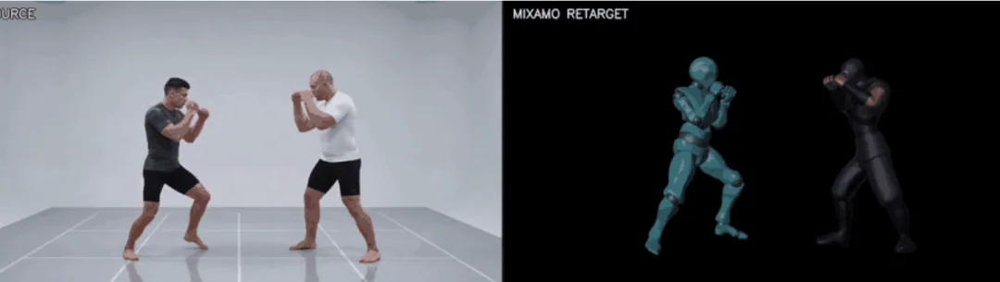

# 视频变成角色动画：Mixamo 动捕里的可检查闭环

把姿态估计、骨架适配、脚部接触和双人碰撞拆开，理解 Agent 可以接手的动画流程。

原标题：用 AI 把任意视频变成 Mixamo 角色动画：Mixamo LLM Mocap

原文：AI for Frontend / 前端设计大神 · 2026-09-17

本站整理：2026-11-06 · [阅读原文](https://mp.weixin.qq.com/s/Rk5UTyMM6d2EpTAFZxKo0A) · [博客文章](https://blog.sidcloud.cn/#/post/mixamo-mocap-agent-animation)

gpt-image-2.5-flare 主题插画 · 通过 sub2-image-gen 生成；正文另附原文素材

视频中的动作很精彩，套到三维角色上却容易露出问题：脚在地上滑、拳头够不到对手，或者换一个体型后动作就变形。原文介绍的 Mixamo LLM Mocap，关注的是这段从参考动作到可编辑骨架的交付过程。它把很多原本只能凭印象提出的修改意见，转成可定位到帧的检查项，适合研究 Agent 怎样参与动画生产。

**阅读要点**

- 固定镜头、完整人物和可识别的支撑状态，是恢复动作的基础。
- 重定向必须使用目标角色的骨架比例，不能只把源关节位置直接复制过去。
- 自动检查能帮助定位问题；原文中的“零脚滑”“任意角色”仍要用自己的素材验证。

## 先认清流程里不同层的数据

**视频到 FK 动画的工作分工**

| 阶段 | 负责的内容 | 值得保存的产物 |
| --- | --- | --- |
| 估计 | 从视频恢复人体姿态和运动 | 估计结果与源片对应关系 |
| 动作规格 | 记录支撑脚、节拍、手势等约束 | action_spec 或对应阶段数据 |
| 重定向 | 按目标骨架长度与静止姿态适配 | 角色 rig_profile 与动画 |
| 检查 | 比较脚部、肢体方向、接触与碰撞 | 逐帧差异与并排预览 |

原文中的双人参考画面与 Mixamo 重定向对照 · 来源：AI for Frontend · [原素材](https://mmbiz.qpic.cn/sz_mmbiz_png/p5aKbB9nc5kRCoRmoRczWKLlIuUQbqibzNL9yzicWTJOPYmvZ5ntsRLvhMQI5hWXYcCS9a7cdR0qlZWdDxeZzxicwibCSziaz08Fw6KhymtCgo78/640?wx_fmt=png&from=appmsg) · [原文](https://mp.weixin.qq.com/s/Rk5UTyMM6d2EpTAFZxKo0A)

## 原文流程与当前仓库有一处区别

公众号发布于 9 月，介绍了 action_spec、Blender MCP 与十个阶段的流程。11 月核对仓库时，默认路径已经增加直接传递 SMPL-X 旋转、后台批量写入 Blender 和保真度评估；原有数据规格路径仍有说明。复现时应先固定仓库版本，再选一条完整路径，避免把不同时间的命令拼在一起。

[核对当前流程：默认路径、旧规格路径与环境要求](https://github.com/squall01337/mixamo-llm-mocap)

## 单人动画先验收什么

- 确认源片的脚部、手部没有长时间离开画面；首尾静止姿态有助于检查标定。
- 记录目标角色的静止姿态、骨骼长度和地面高度，先用短动作检查映射。
- 把脚接触地面的区间与腾空区间分开，避免同一约束同时控制两种状态。
- 同时看正面和侧面，重点检查腕部扭转、髋部高度、穿地与动画首尾衔接。

## 双人场景多了一套接触问题

两个人各自的动作合理，并不代表放在一起就合理。身高和手臂长度改变后，出拳距离、格挡位置和角色间距都会变。原文提到按画面两侧拆分轨道，以及距离、可达范围和网格碰撞检查。实际使用时，人物换边、长时间互相遮挡或拥抱等动作，应当另设失败样例，不把左右分轨当成所有镜头的通解。

**双人动作验收表**

| 检查项 | 发现的问题 | 建议证据 |
| --- | --- | --- |
| 身份和轨道 | 动作是否在接触时串到另一人 | 源片上的轨道覆盖 |
| 交互距离 | 拳脚是否过远或穿过对手 | 俯视与侧视渲染 |
| 地面与根运动 | 两人是否同步漂移或悬空 | 骨盆轨迹和脚部近景 |
| 网格接触 | 粗骨架正常但厚衣服仍穿模 | 最终网格碰撞检查 |

## 建议怎样开始接入

先准备一个自己可用的 Mixamo 角色和一段单人短片，把估计、适配、检查、导出的文件跑通；再换体型，最后增加双人互动。仓库列出的 GPU、Blender 与依赖要求属于项目环境说明，本文没有在本机会话安装或测试这些模型。GVHMR、SMPL-X 等依赖的使用范围，也要与项目代码许可分开核对。

[另一条入口：从提示词生成适合动捕的参考视频](https://blog.sidcloud.cn/#/post/prompt2rig-text-to-motion)

---

基于公开原文独立整理。素材分别注明来源；原文日期与本站整理日期分列。

[返回精读目录](../wechat-reading.md)
