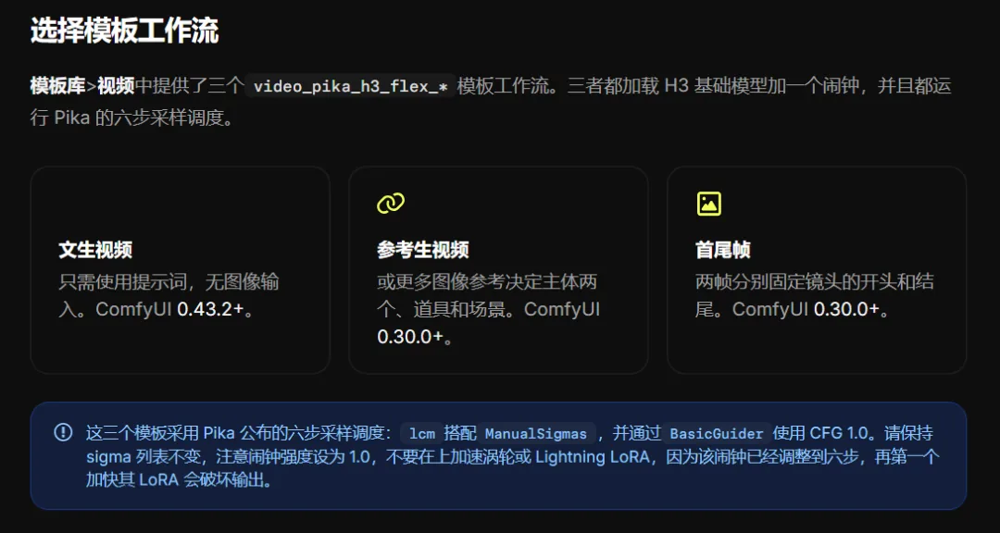
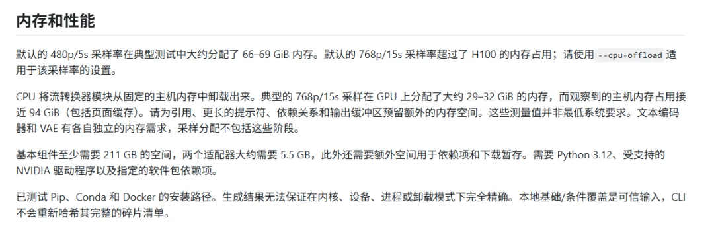

# 六步生成之后：Pika H3 Flex 的速度与边界

把本地适配器、云端扩展与实际资源消耗分开，读懂“更快出片”背后的条件。

原标题：H3 Max一边罚站去！Pika H3 Flex来了，更快更好更便宜！

原文：动画大丸家 / 精选干货 · 2026-10-31

本站整理：2026-11-06 · [阅读原文](https://mp.weixin.qq.com/s/OlcDdYndokBqKGhzourXBw) · [博客文章](https://blog.sidcloud.cn/#/post/pika-h3-flex-speed-and-limits)

gpt-image-2.5-flare 主题插画 · 通过 sub2-image-gen 生成；正文另附原文素材

视频工具更新里，“更快、更好、更便宜”很容易被读成一个没有条件的结论。原文介绍 Pika H3 Flex，既谈六步采样，也列了本地资源限制。这里把这些信息重新摆在一起：先看可下载包提供什么，再看官方云服务扩展什么，最后才判断它是否适合自己的设备和制作节奏。

**先分清三件事**

- 本地开放包支持原生 480p / 768p 和混合立体声音频。
- 更高分辨率与音轨分离是另行提供的云端扩展，不能直接算成本地功能。
- 官方 H100 测量是指定配置的采样占用，不能直接写成消费级显卡的最低需求。

## 本地包与云端服务分别做什么

**发布范围速查**

| 能力 | 本地开放包 | 另行核对的部分 |
| --- | --- | --- |
| 生成方式 | 文生视频、端点帧及多模态参考等模式 | 任务与适配器必须对应 |
| 采样 | 六步生成带同步音频的视频 | 计算时间与完整请求时间分别测 |
| 分辨率 | 原生 480p / 768p | 1080p、2K、4K 属于托管扩展 |
| 声音 | 混合立体声输出 | 独立音轨属于托管接口 |
| 参考输入 | 总量最多 12 份并有类型子限制 | 接受上限不表示任意组合都能装进显存 |

官方包把端点帧与多模态参考放在不同适配器路径下。复现时应按模式核对基础组件、适配器、参考顺序和时长。原文中“最多 12 个参考”不能理解为任意类型都可各放 12 个，也不能因此推导全部最大组合都能成功运行。

原文引用的 ComfyUI 模型文件与工作流说明 · 来源：动画大丸家 · [原素材](https://mmbiz.qpic.cn/mmbiz_png/2Uj9JtpP9LBbVFJABiciaM4ibQ0YVB3M2UVD3wz6LDqtb9PEsqo71VEiazx29mrFJfkZzg1kicmHHCuu58OTAPr3OOKJex8d9ZAJictgjVjTAIibl0/640?wx_fmt=png&from=appmsg) · [原文](https://mp.weixin.qq.com/s/OlcDdYndokBqKGhzourXBw)

## 先把显存、内存与磁盘分开

**官方代表性配置，核对日期 2026-11-06**

| 场景 | 公开测量 | 解读 |
| --- | --- | --- |
| H100 默认模式 · 480p / 5 秒 | 采样分配约 66–69 GiB | 不是整个进程所有阶段的最低显存 |
| H100 CPU offload · 768p / 15 秒 | 采样 GPU 约 29–32 GiB；主机约 94 GiB（含缓存） | 仍要给编码器、VAE 和缓冲留余量 |
| 基础文件与两个适配器 | 基础约 211 GB，加约 5.5 GB 适配器 | 另留依赖、缓存与下载暂存空间 |

原文引用的硬件说明；数值仅适用于注明的测试条件 · 来源：动画大丸家 · [原素材](https://mmbiz.qpic.cn/sz_mmbiz_png/2Uj9JtpP9LAGnXYlztvRURjlKAwSC9OtFDvQQyI4AXbzIMeS8PsMnID8iaVcwib9MUtSHB2DhoopsfMzlKh8CDEWRI0YEH1yt3qvVVT6zeCZU/640?wx_fmt=png&from=appmsg) · [原文](https://mp.weixin.qq.com/s/OlcDdYndokBqKGhzourXBw)

原文也提到社区在 16GB、24GB 显卡上的尝试。这与官方原始包的 H100 测量不是同一条件，往往还涉及量化、ComfyUI 节点、卸载策略和额外内存。要采用社区方案，应保存其具体版本及工作流，而不是把一条显存建议写成整套模型的硬门槛。

## 原文保留的五段演示

原文视频：Pika H3 Flex 参考示例 · 来源：动画大丸家 · [在微信原文查看视频](https://mp.weixin.qq.com/s/OlcDdYndokBqKGhzourXBw)。此图为预览封面。

原文视频：Pika H3 Flex 动作示例 · 来源：动画大丸家 · [在微信原文查看视频](https://mp.weixin.qq.com/s/OlcDdYndokBqKGhzourXBw)。此图为预览封面。

原文视频：ComfyUI 文生视频示例 · 来源：动画大丸家 · [在微信原文查看视频](https://mp.weixin.qq.com/s/OlcDdYndokBqKGhzourXBw)。此图为预览封面。

原文视频：ComfyUI 参考生视频示例 · 来源：动画大丸家 · [在微信原文查看视频](https://mp.weixin.qq.com/s/OlcDdYndokBqKGhzourXBw)。此图为预览封面。

原文视频：ComfyUI 首尾帧示例 · 来源：动画大丸家 · [在微信原文查看视频](https://mp.weixin.qq.com/s/OlcDdYndokBqKGhzourXBw)。此图为预览封面。

这些画面提供内容效果的参考，无法单凭视频判断生成耗时或硬件占用。官方仓库也把创意展示与发布验证区分开。后续比较画质时，先固定角色参考、动作和镜头要求，再分别看身份保持、运动连续、音画配合和最终可用片段比例。

## 怎样安排一轮值得保留的实验

- 先用短片和较低分辨率验证加载与输出，再增加时长和参考数量。
- 分别计入下载、模型加载、采样、编解码和端到端请求时间。
- 用同一提示与参考对比默认配置和 offload，记录显存、主机内存及失败原因。
- 把本地输出和云端高分辨率或音轨服务分别记账，避免混用能力与成本。

## 官方入口与后续对照

[官方仓库：模式、适配器、限制与许可](https://github.com/Pika-Labs/Pika-H3-Flex)

[官方硬件测量：测试范围、采样占用与磁盘说明](https://github.com/Pika-Labs/Pika-H3-Flex/blob/main/docs/hardware.md)

[官方模型与配套素材](https://huggingface.co/Pika-Labs/Pika-H3-Flex)

[原文提供的 ComfyUI 工作流说明](https://docs.comfy.org/zh/tutorials/video/pika/pika-h3-flex)

[现有实测另见测评日志；本文未新增 Flex 本地运行结果](https://blog.sidcloud.cn/#/benchmark)

---

基于公开原文独立整理。素材分别注明来源；原文日期与本站整理日期分列。

[返回精读目录](../wechat-reading.md)
