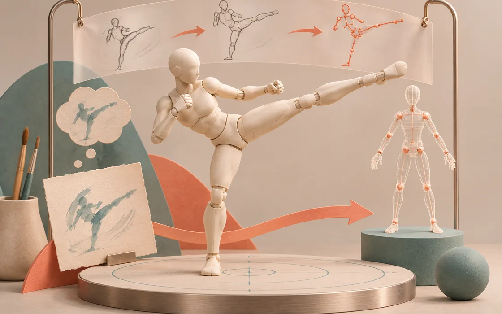
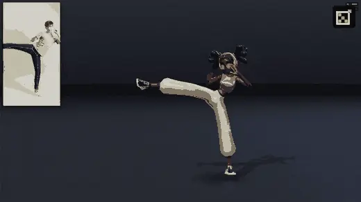
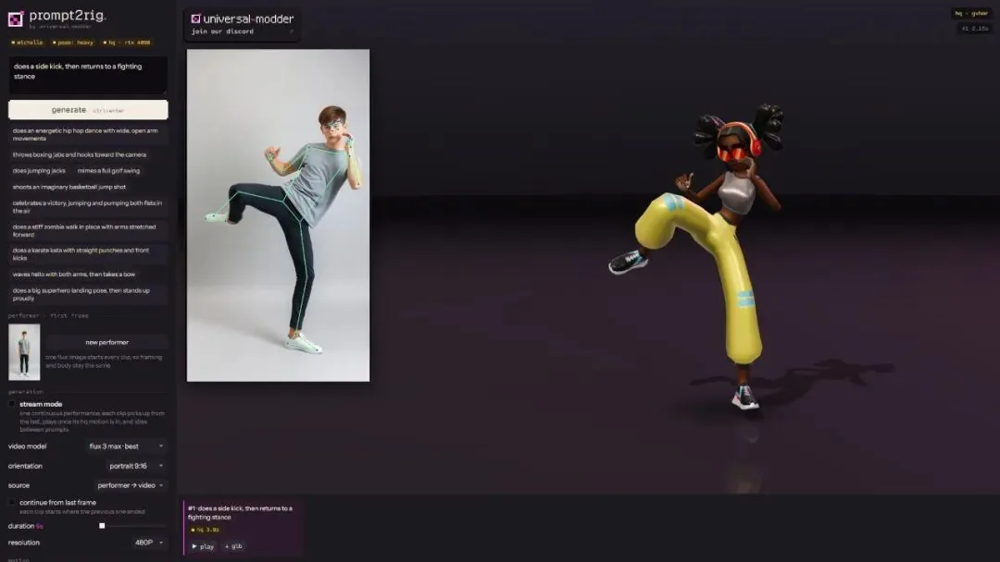

# 一句话，角色动起来：prompt2rig 的动作生产线

从可控视频到身体和手指，再到 Mixamo 骨骼：把动作想法做成可编辑的动画原型。

原标题：打一句「侧踢」，它给你生成会踢腿的 3D 角色，手指都在动

原文：晴天的码场 · 2026-10-29

本站整理：2026-11-06 · [阅读原文](https://mp.weixin.qq.com/s/QcDpAx5wlUJ9TFf_O1cpLQ) · [博客文章](https://blog.sidcloud.cn/#/post/prompt2rig-text-to-motion)

gpt-image-2.5-flare 主题插画 · 通过 sub2-image-gen 生成；正文另附原文素材

想到一个角色动作时，最难跨过的常常是第一版动画。prompt2rig 把这段距离缩短为一条可观察的流程：文字先变成动作视频，姿态估计把画面变成关节运动，浏览器再让绑定好的角色表演。原文用侧踢、舞蹈等例子介绍它；这里按制作环节重新梳理，方便日后决定从哪一步接入自己的动画工作流。

**先记住这三点**

- 视频输入越规范，后续恢复动作越容易；单人、全身、固定镜头比复杂运镜更适合起步。
- 浏览器预览和本地高质量提取分开运行，能先看方向，再等最终动作。
- 网页代码与身体、手部模型的许可不同，导出文件之前就应弄清楚用途。

## 一段动作，经过哪些环节

**动作生产流程**

| 环节 | 输入与职责 | 交给下一步的东西 |
| --- | --- | --- |
| 视频生成 | 提示词与固定的表演者形象 | 动作清楚、人物完整的短片 |
| 快速预览 | MediaPipe 在浏览器估计姿态 | 能立即查看的角色动作 |
| 身体与手部提取 | GVHMR 恢复身体；WiLoR 补充手部 | 关节旋转、根运动与手指动作 |
| 重定向与导出 | 将动作映射到目标 Mixamo 骨架 | 可继续在 Blender 等工具处理的 GLB |

提示词生成的动作与 Mixamo 角色重定向演示（原文动图） · 来源：晴天的码场 · [原素材](https://mmbiz.qpic.cn/sz_mmbiz_gif/65c9fHd9mrY01ibc4XMxib1VJKJw4xpGZzUliaMW3FUFDevPpIrP4QXqx0vLKjNh7Uu22MkN38If3FsKzJHzQK9WCtPTjRC8Lc255S3L47Zp38/640?from=appmsg) · [原文](https://mp.weixin.qq.com/s/QcDpAx5wlUJ9TFf_O1cpLQ)

## 先把参考视频变成好输入

原文强调先生成受控的表演者，而非接受任意镜头。这个选择很实用：如果人物只有半身、手臂长时间交叉、相机又在移动，系统就必须同时猜人物、深度和镜头运动。把这些变量收住，动作原型更容易稳定。第一轮可以只要求一次侧踢或一次挥手，确认重心和关节方向后再增加复杂度。

- 参考片尽量保持单人全身、背景简洁、相机固定，手脚不离开画幅。
- 先选正面或较小侧角的动作；翻滚、背转、贴地动作单独作为困难样例。
- 生成后先检查源视频的人体结构和动作节拍，明显错误的参考不要直接进入提取。

prompt2rig 界面：参考视频、姿态覆盖与角色预览 · 来源：晴天的码场 · [原素材](https://mmbiz.qpic.cn/mmbiz_jpg/65c9fHd9mrZHXEvTicjiaticyUWfrTWJ8eAxM0SPCl2sB6YvYOFaDIBz4dGibPSnH5SdicibRzJ8dkCCjSPdEpHHAm2gtBOUzicia5ebhHS15ialGE1Q/640?from=appmsg) · [原文](https://mp.weixin.qq.com/s/QcDpAx5wlUJ9TFf_O1cpLQ)

## 怎样读懂“几秒出动作”

原文提到 RTX 4090 上约 3.4 秒的高质量提取；核对时，仓库的阶段表还列有约 3.5–4 秒的口径。这些都是指定片长和环境下的阶段时间，云端视频生成、等待、导出并不包含在同一个数字里。要复测，应把生成、提取、重定向和导出分别计时，同时保存片长、分辨率、模型版本及冷启动情况。

## 看动画时，先看脚和手

**建议的动作验收表**

| 位置 | 重点观察 | 保留的证据 |
| --- | --- | --- |
| 支撑脚 | 是否滑动、穿地或突然抬高 | 侧面与正面预览 |
| 骨盆与躯干 | 重心是否跟随动作，根轨迹是否漂移 | 源片与角色并排画面 |
| 腕部和手指 | 左右手是否匹配，遮挡后是否突变 | 手部放大片段 |
| 目标骨架 | 换体型后是否拉伸、反转或穿模 | 导出的骨架与动画文件 |

## 适合把它放在哪一步

它适合角色动作概念验证、独立游戏原型和短镜头预演。涉及双人接触、长时间遮挡或最终商业动画时，还要单独处理接触关系和清理。项目自身的 Apache-2.0 不覆盖高质量链路里的所有依赖；GVHMR、SMPL-X、WiLoR、MANO 要逐项检查。这里整理的是公开案例和项目资料，没有新增一次本地 GPU 实测。

## 资料入口与延伸阅读

[项目仓库：流程、环境与分组件许可表](https://github.com/blendi-remade/prompt2rig)

[继续读：已有参考视频如何进入更细的动画校验闭环](https://blog.sidcloud.cn/#/post/mixamo-mocap-agent-animation)

---

基于公开原文独立整理。素材分别注明来源；原文日期与本站整理日期分列。

[返回精读目录](../wechat-reading.md)
