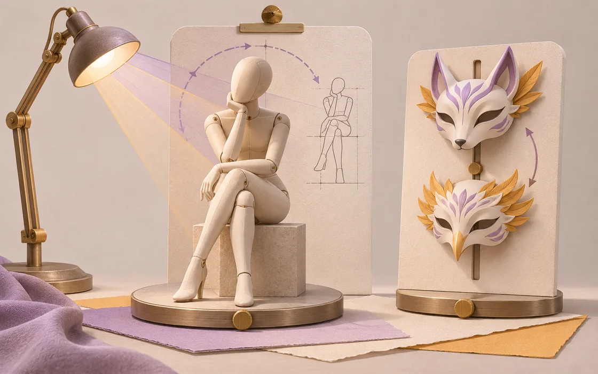
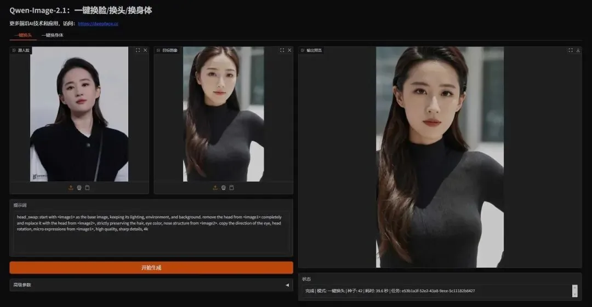
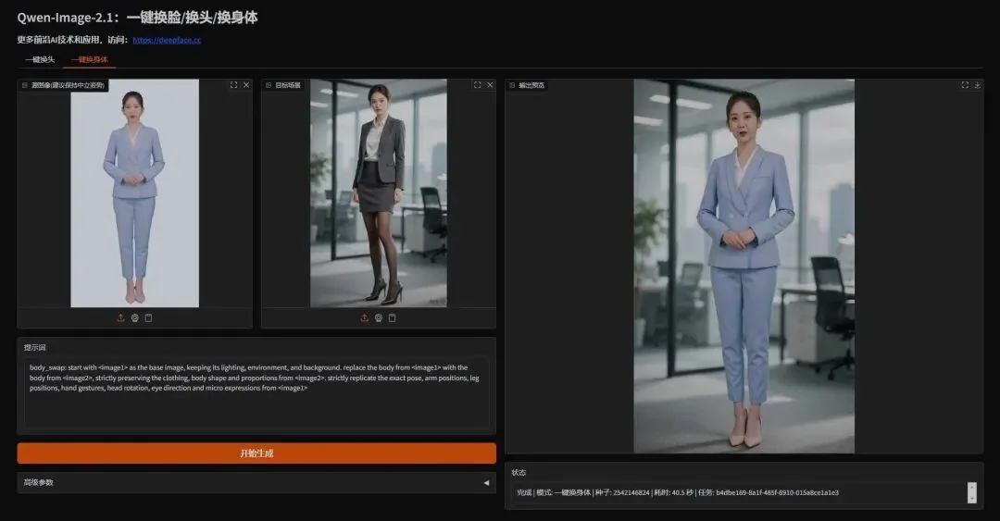

# 换角色，保留场景：读懂 Qwen-FaceSwap 的输入边界

把头部迁移和全身迁移分开理解，保留原文示例，也说明整合包、基础模型与未核实参数的区别。

原标题：Qwen-FaceSwap：一键换头/换脸/换身体，身份迁移自然，姿势光照完美保留

原文：前沿AI资讯技术 · 2026-10-31

本站整理：2026-11-06 · [阅读原文](https://mp.weixin.qq.com/s/PIm1Q_CHKajtWQTsvejErw) · [博客文章](https://blog.sidcloud.cn/#/post/qwen-faceswap-identity-transfer)

gpt-image-2.5-flare 主题插画 · 通过 sub2-image-gen 生成；正文另附原文素材

同一个场景想试几种角色设计时，难点在于保留已经满意的镜头、姿势和环境。原文介绍的 Qwen-FaceSwap 整合了头部与全身两类编辑入口，示例展示的是参考身份怎样迁入目标画面。这里把它整理为输入与验收笔记，方便以后在有授权的角色素材上比较流程。

**先明确要换到哪一层**

- 头部迁移主要改变身份外观，全身迁移还会涉及衣服与体型。
- 参考身份与目标场景各有职责，输入选择比一直沿用默认参数更重要。
- 原文给的是第三方整合包入口，不能据名称推定为 Qwen 官方项目或官方硬件保证。

## 两种任务，保留与变化的部分不同

**迁移任务对照**

| 任务 | 参考图主要提供 | 目标图主要保留 |
| --- | --- | --- |
| 头部 / 面部迁移 | 脸部、发型及身份特征 | 身体、姿态、场景、光照与头部朝向 |
| 全身角色迁移 | 人物身份、服装与体型 | 构图、动作、场景关系与光照 |

原文界面：角色头部迁移示例 · 来源：前沿AI资讯技术 · [原素材](https://mmbiz.qpic.cn/mmbiz_jpg/9Vicvhibbzk4y2NMFFHUDMpqyOg3BCrxIJmvkLYU1zMa1zPO9WfKNfKnOP7szoUKyibF6yTMIs3bwnjQdzfVayukstq8oyetlWdZKs1Nu5V2xk/640?wx_fmt=jpeg&from=appmsg) · [原文](https://mp.weixin.qq.com/s/PIm1Q_CHKajtWQTsvejErw)

## 先把参考图整理成可用输入

头部编辑需要看清五官和发型，全身迁移则最好提供完整人物和服装。只有半身参考时，身体和衣服下半部分并没有事实依据；先扩图只能补出一种设计，不能把补出的内容当作原角色原本就有的细节。可以先人工确认一张完整角色设定，再进入场景迁移。

- 固定参考人物和目标场景各自的版本，避免反复在不同照片间切换。
- 先选遮挡较少、朝向接近的素材，检查脸部连接、发际线和耳部。
- 全身任务额外检查服装轮廓、身体比例、遮挡关系与地面接触。
- 每次记录所用工作流和参数；示例中的“默认可用”不代表所有输入都适用。

原文界面：角色全身迁移示例 · 来源：前沿AI资讯技术 · [原素材](https://mmbiz.qpic.cn/mmbiz_jpg/9Vicvhibbzk4ynkNXx1lQ9UZrvXpjJIqb9Ox4eCmCQWaTkbb9mqp5iaL6qfflJaBPXDaofWfOXHt25xs0H5hFLqABFEJgiasl5QNUA2PHwYIDLs/640?wx_fmt=jpeg&from=appmsg) · [原文](https://mp.weixin.qq.com/s/PIm1Q_CHKajtWQTsvejErw)

## 哪些信息还需要继续核实

原文称其基于 Qwen-Image-2.1，并给出 NVIDIA 显卡、8GB 起步和部分显卡代际支持等说明。此次能核对到的是原发布页中的包结构与操作介绍，没有获得独立的基础模型卡、统一测试配置或该整合包的完整许可。因而这些项目保留为原作者说明，不升级为官方事实，也不承诺在某张显卡上一定可运行。

**后续采用前的资料核对**

| 资料 | 当前能确认 | 仍需补齐 |
| --- | --- | --- |
| 发布入口 | 原文与第三方发布页相互对应 | 可固定版本的公开源码或发布标签 |
| 基础权重 | 原文标注了模型名称 | 精确模型 ID、量化与依赖版本 |
| 资源需求 | 发布方给出起步建议 | 分辨率、时长与峰值显存记录 |
| 使用范围 | 示例展示编辑能力 | 各权重、节点和素材的许可条件 |

## 怎样判断迁移是否成功

可以先把结果缩小，看人物是否仍自然处于原场景；再放大检查身份、眼神、边缘和遮挡。只看脸像不像会漏掉脖子长度、光线方向和服装与手的关系。建议保留同一场景下的多个种子和失败例，分别记录身份保持、姿势保持和光照融合，避免一句“很自然”掩盖三类不同问题。涉及真实人物时，应使用已获许可的素材，并清楚标注编辑性质。

## 保留原始入口

[原文提供的第三方发布页：包结构与使用说明](https://deepface.cc/thread-1153-1-1.html)

[关联阅读：把身份与结构参考分工写清楚](https://blog.sidcloud.cn/#/post/ai-image-repair-structure-style)

---

基于公开原文独立整理。素材分别注明来源；原文日期与本站整理日期分列。

[返回精读目录](../wechat-reading.md)
