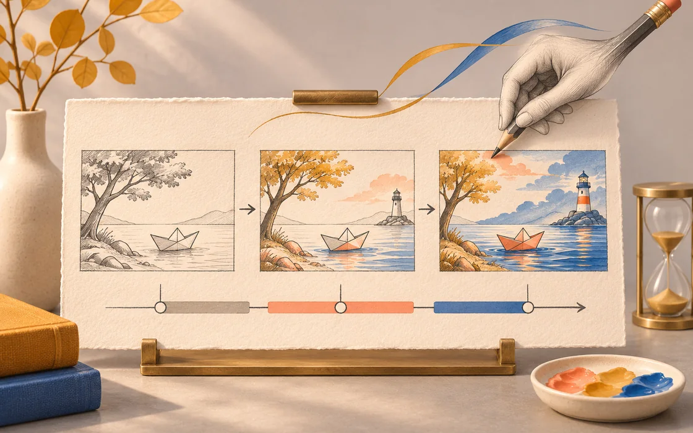
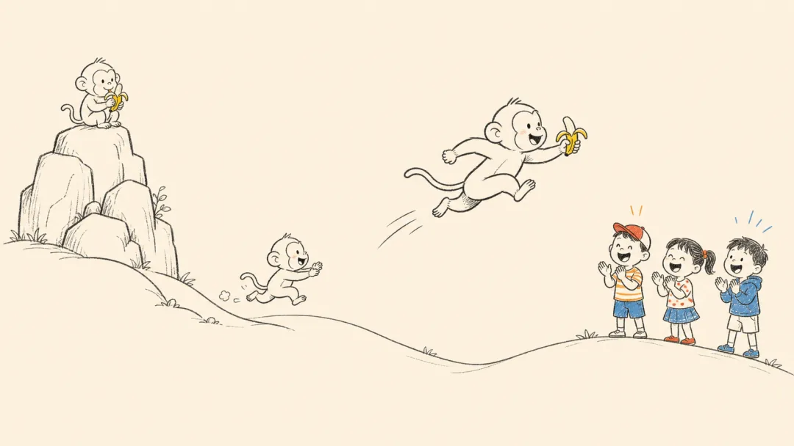
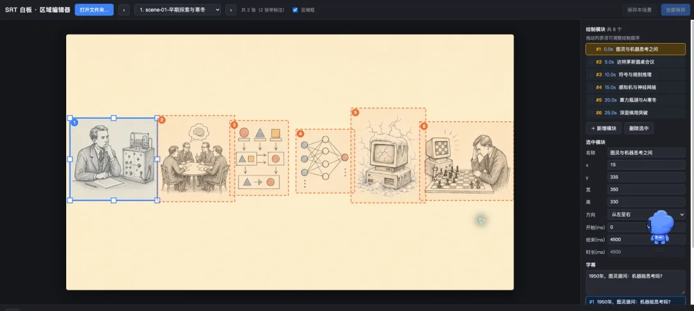

# 字幕就是时间轴：把讲解做成白板手绘动画

从 SRT 到分镜、线稿和区域标注，再到逐幕渲染，让画面沿着讲述顺序出现。

原标题：又一个神级Skill：字幕丢进去，AI自动生成手绘动画视频

原文：极客之家 / 丛林 · 2026-09-30

本站整理：2026-11-06 · [阅读原文](https://mp.weixin.qq.com/s/I3up8jG30FRFoYakYBz8Kw) · [博客文章](https://blog.sidcloud.cn/#/post/srt-whiteboard-animation-storytelling)



gpt-image-2.5-flare 主题插画 · 通过 sub2-image-gen 生成；正文另附原文素材

一段知识讲解配一张完整插图，观众可能在第一秒就看到结尾。白板手绘动画的不同之处，是让人物、物件和关系随讲述逐渐出现。原文介绍的 srt-whiteboard-animation，从带时间的字幕出发，把拆幕、线稿、区域标注和绘制连成一条流程。这里保留其原文动图、线稿和预览台，便于以后查做法。

**先抓住时间与叙事**

- 字幕提供时间锚点，分镜决定每幕要说明的一件事。
- 绘制顺序应跟随语义，不能简单按画面从左到右扫描。
- 先检查区域和中间帧，再渲染整片，能更早发现提前露出和节奏错误。

## 先看原文的逐步绘制效果


原文手绘动画示例：元素随叙事逐步出现（动图） · 来源：极客之家 · [原素材](https://mmbiz.qpic.cn/sz_mmbiz_gif/38IO1Mnhnaz9y0VPG2ibc6lTSXZEnDp091iaKKIjBFXmcsMdzbVvbfJucIdGCy6V20bSD78Brico9Tr4iauHnW7D2KNvJ4CQDiaoibcGMiaC1JCVvk/640?wx_fmt=gif&from=appmsg) · [原文](https://mp.weixin.qq.com/s/I3up8jG30FRFoYakYBz8Kw)

动图展示的是作者提供的样例，不是本次重新制作的视频。观察时可以注意：完整背景没有一开始全部出现，后续人物也随着叙事进入。真正的制作难点，是把每个画面元素与具体字幕事件对上，再确保后画的内容不会被前一步提前揭开。

## 从字幕到成片的六份产物

**白板动画制作顺序**

| 阶段 | 产物 | 本阶段先检查 |
| --- | --- | --- |
| 解析字幕 | 时间与事件清单 | 时间码、句子与旁白是否对应 |
| 拆分场景 | 每幕的叙事目标 | 一幕是否承载过多意思 |
| 准备线稿 | 统一风格的完整构图 | 角色、动作与留白是否清楚 |
| 建立标注 | 区域、顺序、时长与字幕关联 | 像素坐标与遮挡关系是否正确 |
| 预览校正 | 分区与中间帧检查 | 是否提前露出、笔迹是否跟得上 |
| 逐幕渲染和合并 | 每幕 MP4 与总成片 | 结尾停留、字幕和画面是否衔接 |

项目建议以约 25–35 秒作为拆幕起点，但这个时长不是必须遵守的叙事定律。复杂的因果关系可以拆成两幕，短的概念也不需要硬凑到半分钟。先根据字幕中的事件划分，再用预览判断观众是否来得及看清。



原文线稿示例：先确定整幕的构图与角色关系 · 来源：极客之家 · [原素材](https://mmbiz.qpic.cn/mmbiz_png/38IO1MnhnazjsF3szXoXX1rlqCYCfC8icA5fOWMibsKM99bBXxzDdwp8iaImbOGCXpGnzYMIMZpFl72NGhYPhibB9CkyCJJY7wEGez4LPibF7cNI/640?wx_fmt=png&from=appmsg) · [原文](https://mp.weixin.qq.com/s/I3up8jG30FRFoYakYBz8Kw)

## 标注决定先画谁、画多久

标注需要知道画布尺寸、元素区域、出场顺序、开始时间和绘制时长。遇到重叠对象，还要保护后出现的区域，防止一笔擦出未来的角色。原文中间设有预览台，用来调位置、顺序与时间；这是把整段重渲染拆成小问题的关键环节。



原文预览台：分区、顺序与字幕时间关联 · 来源：极客之家 · [原素材](https://mmbiz.qpic.cn/sz_mmbiz_png/38IO1Mnhnawv5ibic8pmctcT1gibyDLW9af96FDWic01pVOvRB3bWQ873ibiaDKT41ib3f1K6cUZNPU7icFaoXXNRsqibJg8iaOUd89HxBhMVqpTYXdts/640?wx_fmt=png&from=appmsg) · [原文](https://mp.weixin.qq.com/s/I3up8jG30FRFoYakYBz8Kw)

```txt
整理示例：一句旁白对应一组事件
00:00–00:03  画出地点，留出角色位置
00:03–00:06  主角出现，尚未揭示后续结果
00:06–00:09  动作与关系变化
00:09–00:10  保留完整画面，等待切幕
实际时长以字幕和预览为准。
```

## 成片前看这几个时刻

- 首帧：底纸是否干净，未来内容有没有提前出现。
- 第一处转折：字幕提到的角色或物件是否及时出现，画面是否拥挤。
- 遮挡交接：早出现的区域有没有揭开后续元素。
- 每幕末尾：是否给读者看清完整关系的停留时间。
- 合并位置：声音是否断开、时间码是否重叠、画面风格是否改变。

[](https://mp.weixin.qq.com/s/I3up8jG30FRFoYakYBz8Kw)

原文视频：AI 发展简史白板动画成片 · 来源：极客之家 · [在微信原文查看视频](https://mp.weixin.qq.com/s/I3up8jG30FRFoYakYBz8Kw)。此图为预览封面。

## 怎样把它变成长期可维护的项目

每幕至少保留字幕、线稿、标注和渲染结果，文件名互相对应。修改某句旁白时，先检查该幕的时序和元素关联，再决定是否重画或重渲染。分镜、线稿和时序各自形成一个可回退的版本，局部出问题时就能从对应环节修改。本文保存的是原作者案例与公开工具入口，适合将来按自己的字幕重新建立项目。

## 项目、预览与相关笔记

[官方仓库：示例、标注格式、预览台与渲染脚本](https://github.com/geeklee/srt-whiteboard-animation)

[前一步：先把视频整理成可检索的字幕资料](https://blog.sidcloud.cn/#/post/subforge-subtitle-research-pipeline)

[前一步：先把讲稿改得更清楚](https://blog.sidcloud.cn/#/post/humanizer-clearer-ai-writing)

---

基于公开原文独立整理。素材分别注明来源；原文日期与本站整理日期分列。

[返回精读目录](../wechat-reading.md)
