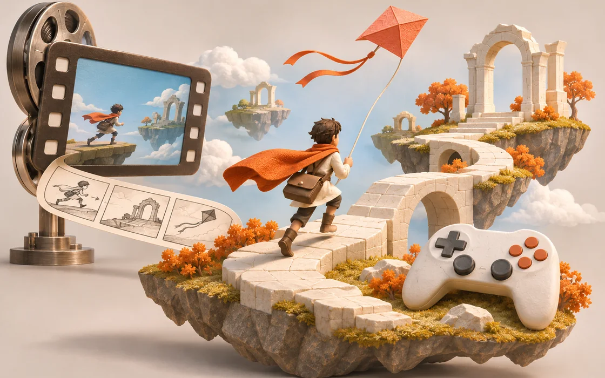
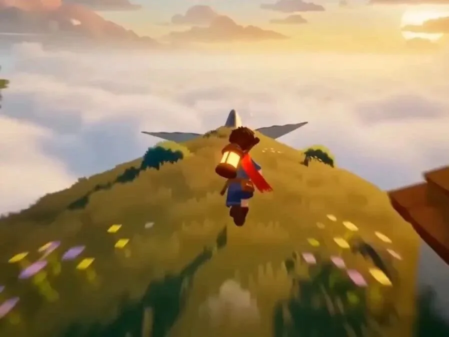

# 从一段视频长出小游戏：让画面先定义玩法

video-to-game 把视频概念、资产制作、代码实现和试玩串起来，值得借鉴的是每一步怎样对齐。

原标题：Video to Game：把一段视频变成可玩的 Three.js 小游戏

原文：AI for Frontend / 前端设计大神 · 2026-10-29

本站整理：2026-11-06 · [阅读原文](https://mp.weixin.qq.com/s/1ECp10_o9BA1I3HPBWkAUA) · [博客文章](https://blog.sidcloud.cn/#/post/video-to-game-playable-prototype)

gpt-image-2.5-flare 主题插画 · 通过 sub2-image-gen 生成；正文另附原文素材

让 Agent 写一个小游戏，第一版通常很快能打开，但角色、镜头和玩法可能各说各的话。video-to-game 选择先做一段玩法概念视频，让它成为可见的设计参考，再把画面里的机制落实为代码。原文介绍了这条流程和公开作品集；这里把它拆成一份从概念到验收的制作笔记。

**这条流程最值得借鉴的部分**

- 视频先确定镜头、角色和气氛，文字规格再解释玩家输入与游戏规则。
- 所有资产都对照同一段参考，减少图片、模型、音乐之间的风格偏差。
- 交付前必须实际试玩，成功片段和失败修复都应留记录。

## 一段视频还缺什么，才能成为设计稿

画面能告诉人“这是一场滑翔冒险”，却不能自动决定碰撞盒、失败条件、相机跟随或输入响应。把视频转成设计稿时，先写出唯一核心机制，再补开始、成功和失败的状态。若连玩家每一秒要做什么都说不清，继续生成模型和音乐只会增加返工。

**从视频提取可执行规格**

| 视频能提供 | 还需写明 | 如何检查 |
| --- | --- | --- |
| 镜头与景别 | 相机跟随、遮挡与边界 | 同一位置的参考帧与游戏画面 |
| 角色与场景风格 | 资产比例、色板、加载方式 | 角色放进实际场景后比较 |
| 动作和节奏 | 按键、移动速度、碰撞规则 | 用固定操作走完整段 |
| 情绪与声音 | 音效触发与音乐循环位置 | 开声音试玩并记录触发事件 |

原文视频：由玩法概念发展出的浏览器游戏演示 · 来源：AI for Frontend · [在微信原文查看视频](https://mp.weixin.qq.com/s/1ECp10_o9BA1I3HPBWkAUA)。此图为预览封面。

## 把制作分成五份可验收的产物

- 概念包：保存玩法视频、关键帧、色板和一句话玩法。
- 规格包：明确镜头、角色、核心机制、胜败条件与关键时刻。
- 资产包：按同一参考生成或准备图片、三维模型、动作和声音，并记录来源。
- 实现包：先跑通核心循环，再补美术细节；每次变化都回到原视频比对。
- 试玩包：保存操作路线、发现的问题、修复结果与实际运行片段。

## 怎样理解公开的成本和作品数量

原文和项目展示过 31 个游戏、总计约 202 美元及上千次素材调用。这是一批已展示作品的制作账单，适合了解流程组成；它不能保证下一个想法也只花几美元。失败重做、生成素材大小、人工修改和试玩时间，都会改变成本。后续评估时，最好把概念视频、资产生成与运行验证分别记账。

## 浏览器原型交付时要看什么

**建议的交付清单**

| 项目 | 最低检查内容 | 常见遗漏 |
| --- | --- | --- |
| 核心循环 | 能开始、推进、结束并重开 | 只有移动演示，没有游戏目标 |
| 控制与相机 | 按键响应一致，视野可读 | 相机被场景挡住或跟随抖动 |
| 资源与设备 | 资源路径正确，目标设备能加载 | 本地路径、过大资产、音频没触发 |
| 证据 | 保留可复现操作与实际录像 | 用概念视频替代游戏实录 |

项目主打较轻的 Three.js 网页交付，但“单个入口 HTML”不等于零依赖，也不保证离线运行；模型、音频和库文件仍要检查路径与许可。将来复用这条思路时，可以先做一个 30 秒内能走完的玩法原型，用实际试玩决定要不要继续扩大。本文未重新制作作品集中的游戏。

## 项目与可玩的作品集

[官方仓库：流程、工具、成本记录与游戏源码](https://github.com/lovisdotio/video-to-game)

[公开试玩：从概念视频到浏览器游戏的作品集](https://fal-video-to-game.vercel.app)

[关联阅读：用多视角参考约束游戏中的硬表面资产](https://blog.sidcloud.cn/#/post/eight-view-ai-3d-blockout)

---

基于公开原文独立整理。素材分别注明来源；原文日期与本站整理日期分列。

[返回精读目录](../wechat-reading.md)
