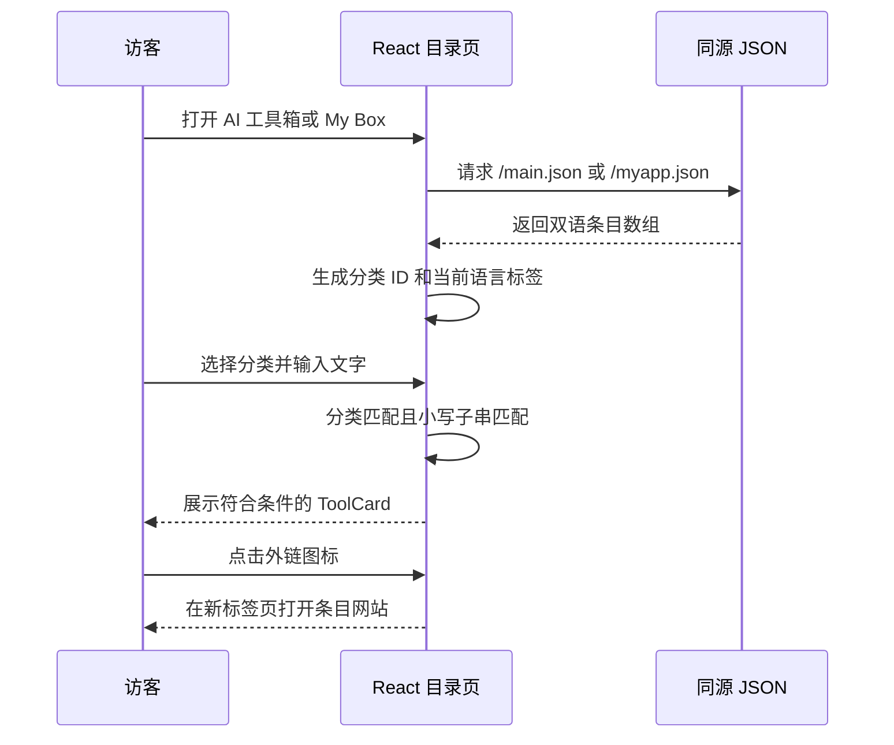

# 架构与运行逻辑

[README](../../README.zh-CN.md) · [English](../en/architecture.md)

## 系统范围

官网采用静态单页应用方案：React 18 渲染界面，TypeScript 描述组件和数据类型，React Router 6 处理页面切换，i18next 管理翻译，Tailwind CSS 提供样式，Framer Motion 提供页面和卡片动效。Vite 5 将应用构建为 `dist/`，交给 Vercel 托管。

应用读取公开 JSON 和本地图片，没有应用后端、数据库、用户登录、支付流程或后台编辑器。Vercel OAuth 属于维护者本机的部署工具，不进入浏览器代码。独立维护的博客和私人研究工作区不纳入本仓库。

## 启动与页面组合

1. [`index.html`](../../index.html) 加载 [`src/main.tsx`](../../src/main.tsx)。
2. 入口引入全局 CSS，初始化 i18next，并使用 `HelmetProvider`、`BrowserRouter` 包裹 `App`。
3. [`App.tsx`](../../src/App.tsx) 匹配路由，通过 `AnimatePresence` 和 `PageTransition` 提供切换动画。
4. [`Layout.tsx`](../../src/components/Layout.tsx) 提供桌面/手机导航、语言按钮、页面 `Outlet`、页脚以及外部 Live2D 装饰组件。
5. 各页面渲染内容，并向 [`Seo.tsx`](../../src/components/Seo.tsx) 传入翻译键，在浏览器中更新标题、简介及 Open Graph 标题/简介。

| 路径 | 组件 | 内容来源 |
| --- | --- | --- |
| `/` | `Home` | `src/data/site.ts`、`projects.ts`、`founder.ts`、`updates.ts`、`assets.ts` 及翻译键 |
| `/aitoolbox` | `AiToolbox` | `public/main.json`，通过 `/main.json` 请求 |
| `/mybox` | `MyBox` | `public/myapp.json`，通过 `/myapp.json` 请求 |
| `/devtoolbox` | `DevToolbox` | `src/data/toolbox.ts` 中开发工具条目/分类及界面翻译 |
| 其他客户端路径 | `NotFound` | 带返回首页入口的“Signal Lost”翻译页面 |

首页由介绍区、三大研究方向、六个精选项目、日期动态、图片画廊及开发者信息组成。项目卡片展示并链接到外部服务，这些外部服务的业务逻辑不在本站内实现。

## 目录加载、筛选与外链

组件每次挂载请求一次对应 JSON。成功且为数组的响应进入组件状态；网络失败、JSON 无法解析或返回非数组时使用空数组。当前没有单独的网络错误或加载提示。`useMemo` 根据状态变化即时重新计算筛选结果。

搜索范围由当前语言的名称、简介、来源方、分类名和标签拼接而成，再转换为小写，执行 `includes(query.toLowerCase())`。分类按稳定的分类 ID 匹配，两项条件必须同时满足。这是普通子串查询，没有模糊排序、分页或远程搜索服务，也不会自动去掉输入两端空格。切换语言会改变参与搜索的文本，切换路由后页面重新挂载，局部筛选条件重置。

分类按数据中的首次出现顺序生成，“全部”取消分类限制。`ToolCard` 展示名称、简介、标签、分类、来源方和外链图标。访问目标依次为 `website`、`sources` 的首项、已有的 `https://example.com` 回退地址。目前内容检查要求两个正式 JSON 目录都提供合法 HTTP(S) `website`。

开发工具箱使用打包在源码中的演示数组，也采用“分类且文本匹配”的交互。搜索字段为翻译后的名称、摘要、使用场景及标签，分类比较对应的翻译键。该页不请求目录 JSON，五个外链目前均为占位地址。

## 语言逻辑

[`src/i18n/index.ts`](../../src/i18n/index.ts) 优先读取 `localStorage["sidcloud-lang"]`，再读取浏览器语言，并缓存选择。支持 `en-US` 和 `zh-CN`，回退语言为英文。导航栏按钮在两种语言间切换。

界面文本来自 [`translations.ts`](../../src/i18n/translations.ts)。目录文本由 [`localizedToolbox.ts`](../../src/lib/localizedToolbox.ts) 解析：纯字符串直接使用；对象依次选择当前语言、英文、中文，均无内容时返回空字符串。该辅助函数只有对精确的 `zh-CN` 使用中文。损坏但非空的翻译不会触发回退。

页脚在两种界面语言下均保留用户指定的中文文案：旧链接显示带删除线的 `Github(惨遭封禁)`，紧邻的 GitHub 图标及 `现任仓库` 指向 `https://github.com/wikigsroom`。人物和项目中的其他 GitHub 链接使用各自配置。

## 视觉与托管逻辑

[`src/index.css`](../../src/index.css) 和 [`tailwind.config.ts`](../../tailwind.config.ts) 定义暗色背景、青色/粉色高亮、玻璃面板、渐变和扫描线。本地图片通过 [`assets.ts`](../../src/data/assets.ts) 映射。导航分别提供桌面和手机布局。首页部分内容在进入视口时播放动画，因此媒体脚本在截取完整首页前会滚动整个文档。

Google Fonts 和 Live2D 是外部运行依赖。文档采集时才单独屏蔽，以避免网络超时和组件错误；发布的应用仍会请求它们。

Vercel 上传源码后执行 `npm run build`；[`vercel.json`](../../vercel.json) 明确指定 `vite` 和 `dist`。`public/` 中的 JSON 被复制到部署根目录。图片和请求路径使用绝对路径，默认在域名根路径托管，不适合直接改为子目录部署。

客户端路由与服务器路由需要分别验证。当前配置没有 SPA rewrite；既有线上检查发现，直接打开或刷新内部页面会返回 HTTP 404，而从首页点击导航可正常切换。文档使用的本地 Vite 预览具有 SPA 回退能力，因此本地截图不能证明正式站刷新问题已解决，详见[已知问题](known-issues.md)。

## 仓库维护机制

- `check-content.mjs` 检查目录条目、图片引用和 Vercel 输出设置。
- `check-docs.mjs` 检查文档本地链接，以及素材是否与清单一致。
- 页面源码指纹涵盖 `src/`、`public/`、`index.html`、`tailwind.config.ts` 和 `vite.config.ts`；文本换行差异会统一处理，支持跨平台 checkout。
- 原生 PowerShell [`vercel.ps1`](../../scripts/vercel.ps1) 固定独立账户、团队和项目，并在部署前运行发布检查。
- CI 验证提交后的源码和材料，不登录 Vercel，也不自动部署。

继续阅读[内容维护](content.md)、[部署与更新](operations.md)或[媒体生成](media.md)。
